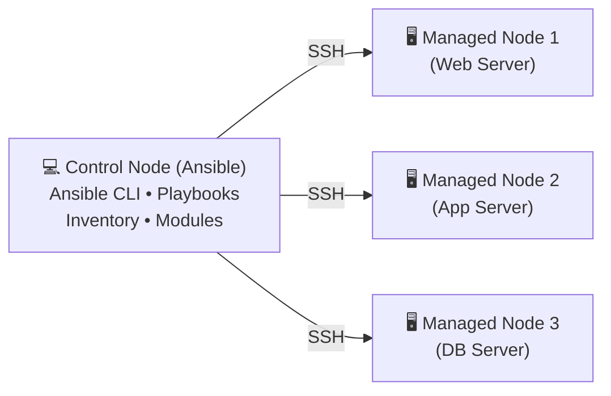
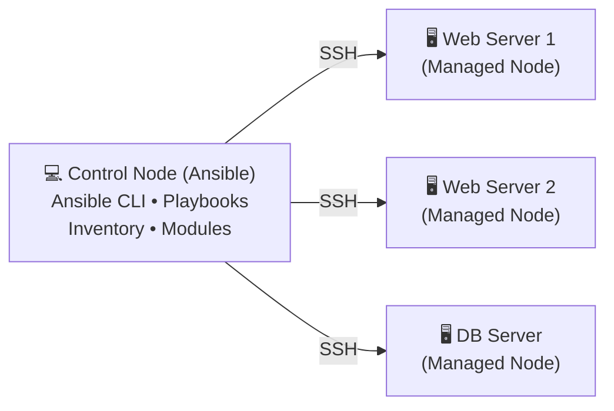
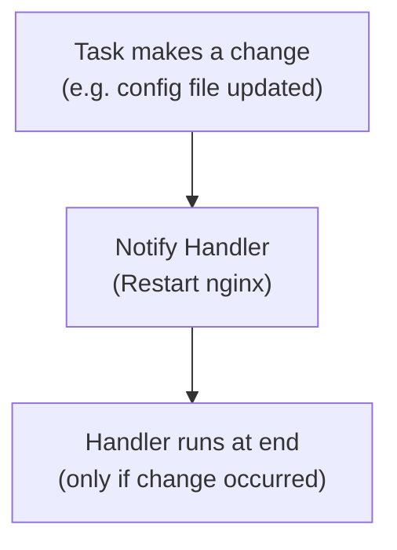

# Ansible

**Automation Made Simple**

> [!quote] Configure • Deploy • Automate Your Infrastructure
> "Automate Today for a Better Tomorrow"
> Simple. Agentless. Powerful. Open Source.
> 🖥️ Configuration Management • ⚙️ Application Deployment • ✅ Task Automation • ☁️ Cloud Provisioning

> [!abstract] عن هذا الملف — مرجع واحد
> دمج للملاحظتين: ==النظري المنظم== (Ansible1) + ==اللاب العملي الكامل== (Ansible) في مرجع واحد.
> كل اللابات والمخرجات الأصلية محفوظة داخل ==Toggles مطوية== `[!example]-` — افتح ما تحتاجه فقط.
> ملاحظات مرتبطة: [[Linux]]

## Contents

- [[#Introduction]]
- [[#Installation & First Setup]]
- [[#Inventory]]
- [[#Ansible Vault]]
- [[#Ad-Hoc Commands & Modules]]
- [[#Playbooks & YAML]]
- [[#Variables, Facts & Conditionals]]
- [[#Loops, Templates, Handlers & Tags]]
- [[#Error Handling & Blocks]]
- [[#Roles]]
- [[#Full Lab — vsftpd File Server]]
- [[#Alerts & Notifications]]
- [[#REST APIs & Webhooks]]
- [[#Resources & Links]]

## Introduction

### 1. What is Ansible?

> [!info]
> Ansible is an ==🟡open source== automation tool used for configuration management, application deployment, task automation and orchestration.
> It helps you ==🟢manage multiple servers== from a single control node without installing any agent on target servers (==🟡Agentless==).

### 2. Why Use Ansible?

- Simple and easy to learn.
- Agentless (uses SSH).
- Automates repetitive manual tasks.
- Consistent and reliable deployments.
- Supports configuration management and orchestration.
- Idempotent (makes only required changes).
- Large community support (open source).

> [!quote] Automate Infrastructure for a Better Tomorrow

### 3. Ansible Architecture



> [!tip] Architecture Highlights
> Agentless • Push Based • Uses SSH • Manages Multiple Servers • Supports Linux, Windows, Cloud

### 4. Important Terminology

| Term | Meaning |
| --- | --- |
| Control Node | System where Ansible is installed and from where you run commands. |
| Managed Node | Target servers that Ansible manages. |
| Inventory | List of managed nodes (servers). |
| Playbook | YAML file containing automation tasks. |
| Play | A set of tasks to be executed on hosts. |
| Task | A single action (uses a module). |
| Module | Reusable unit of code to perform a specific task. |
| Role | A way to organize playbooks, files, templates and variables. |

### 5. Quick Tip

> [!tip]
> Ansible is ==AGENTLESS== and uses ==SSH== for communication.

## Installation & First Setup

> [!quote] Install Once, Automate Everything

### 1. Install Ansible on Linux (Control Node)

Ansible can be installed using package manager (dnf/yum/apt) or using pip.

**For RHEL / CentOS / Amazon Linux**

```bash
# Install EPEL repository
sudo yum install -y epel-release
# Install Ansible
sudo yum install -y ansible
# Verify installation
ansible --version
```

**For Ubuntu / Debian**

```bash
sudo apt update
sudo apt install -y ansible
ansible --version
```

### 2. Verify Ansible Installation

```bash
ansible --version
```

Expected Output (sample):

```text
ansible [core 2.15.0]
  config file = None
  python version = 3.9.16
  executable location = /usr/bin/ansible
```

### 3. Setup SSH Key for Passwordless Authentication

```bash
ssh-keygen -t rsa -b 4096
ssh-copy-id user@<server-ip>
```

> [!note]
> Ansible uses SSH for communication, so ==passwordless access is required==.

### 4. Create Inventory File

```bash
sudo nano /etc/ansible/hosts
```

```ini
[web]
web1 ansible_host=192.168.1.10
web2 ansible_host=192.168.1.11

[db]
db1 ansible_host=192.168.1.20
```

### 5. Test Connectivity

```bash
ansible all -m ping
ansible web -m ping
ansible-inventory --list
```

### 6. Setup Complete - Architecture



> [!tip] Key Points
> Ansible is installed ==only on Control Node==. Uses ==SSH==. ==No agent== on managed nodes. Inventory contains list of servers. ==Test connectivity== before running playbooks.

> [!example]- 🧪 اللاب الكامل: تجهيز Control + 3 عقد (ansible1/2/3) من السجل الأصلي — اضغط للفتح
> **على جهاز التحكم — إنشاء المستخدم والصلاحيات والتثبيت:**
> ```bash
> useradd ansible
> echo 'P@ssw0rd' | passwd --stdin ansbile
> echo 'ansible ALL=(ALL)       NOPASSWD:ALL' > /etc/sudoers.d/ansible
> yum install epel-release -y
> yum install python3 ansible
> python3 --version
> for i in {1..3}; do scp /etc/hosts ansible"$i":/etc/hosts; done
> ```
>
> **توليد مفتاح SSH ونسخه:**
> ```bash
> su - ansible
> ssh-keygen
> for i in {1..3}; do ssh copy id ansible"$i".example.com:/etc/hosts; done
> ```
>
> **ملف الـ hosts:**
> ```text
> cat /etc/hosts
> 192.168.121.148  control control.example.com
> 192.168.121.147  ansible1 ansible1.example.com
> 192.168.121.142  ansible2 ansible2.example.com
> 192.168.121.146  ansible3 ansible3.example.com
> ```
>
> ```bash
> sudo hostnamectl set-hostname control
> for i in {1..3}; do ping -c 2 ansible$i ; done
> ```
>
> **تجهيز المستخدمين على كل العقد بحلقات SSH:**
> ```bash
> for i in {1..3}; do ssh ansible$i "useradd ansible" ; done
> # P@ssw0rd
> for i in {1..3}; do ssh ansible$i "echo P@ssw0rd | passwd --stdin ansbile" ; done
> for i in {1..3}; do
>   ssh ansible$i "echo \"ansible:P@ssw0rd\" | sudo chpasswd"
> done
> for i in {1..3}; do ssh ansible$i "echo 'ansible ALL=(ALL)       NOPASSWD:ALL' > /etc/sudoers.d/ansible"; done
> for i in {1..3}; do ssh ansible$i "python3 --version" ; done
> for i in {1..3}; do ssh-copy-id ansible$i ; done
> ```
>
> ```text
> <سطر كلمة مرور حقيقية كان هنا — حُذف لأسباب أمنية، انقل أي كلمة مرور حقيقية إلى Ansible Vault>
> ```

> [!warning] أخطاء مطبعية في السجل الأصلي (أُبقيت كما وردت أعلاه)
> - `ansbile` ← الصحيح `ansible` (ولهذا فشل `passwd --stdin` واضطر السجل لاستخدام `chpasswd` لاحقًا — الحل الصحيح موجود في اللاب نفسه).
> - `ssh copy id ansible"$i".example.com:/etc/hosts` أمر مكسور — الصحيح `ssh-copy-id ansible$i` (وهو ما نُفذ فعلًا في نهاية السجل).

> [!example]- ⚙️ ansible.cfg كما ورد في السجل — اضغط للفتح
> ```ini
> $ cat ansible.cfg
> [defaults]
> inventory = inventory
> remote user = ansible
> #host_key_checking = false
>
> [privilege_escalation]
> become = True
> become method = sudo
> become user = root
> become_ask_pass = False
> ```

> [!warning] النسخة أعلاه لن تعمل — مفاتيح بمسافات
> `remote user` و`become method` و`become user` ==مفاتيح غير صالحة==. النسخة الصحيحة:
> ```ini
> [defaults]
> inventory = inventory
> remote_user = ansible
> #host_key_checking = false
>
> [privilege_escalation]
> become = True
> become_method = sudo
> become_user = root
> become_ask_pass = False
> ```

## Inventory

> [!quote] Inventory Defines Where to Work

### 1. What is Inventory?

Inventory is a file that contains a ==🟡list of managed nodes== (servers) on which Ansible will run commands, playbooks and modules. It can be a ==🟢static file== or ==🟡dynamic== (e.g. from AWS, Azure, etc.).

### 2. Types of Inventory

| Type | Description | Example |
| --- | --- | --- |
| Static Inventory | Manually create a file with host details. | inventory.ini |
| Dynamic Inventory | Generated from cloud providers (AWS, GCP, Azure, etc.). | aws_ec2.py |
| INI Format | Simple and commonly used format. | hosts.ini |
| YAML Format | More structured and powerful format. | inventory.yml |

> [!tip] Benefits of Inventory
> Manage multiple hosts easily. Group servers logically. Support for dynamic environments (cloud). Flexible format (INI, YAML, dynamic). Makes playbooks reusable.

### 3. Static Inventory (INI Format)

```ini
[web]
web1 ansible_host=192.168.1.10
web2 ansible_host=192.168.1.11

[db]
db1 ansible_host=192.168.1.20
```

> [!note] Explanation
> Groups are defined using `[group_name]`. Hosts are added under each group. You can create child groups using `[parent:children]`. You can also define variables like `ansible_host`, `ansible_user`, etc.

### 4. Inventory in YAML Format

```yaml
all:
  children:
    web:
      hosts:
        web1:
          ansible_host: 192.168.1.10
        web2:
          ansible_host: 192.168.1.11
    db:
      hosts:
        db1:
          ansible_host: 192.168.1.20
```

> [!note] Explanation
> YAML format is ==more structured and readable==. Useful for complex environments. Supports groups, child groups and variables.

### 5. Group Variables and Host Variables

- `group_vars/` → Variables for a group (e.g. web, db).
- `host_vars/` → Variables for a specific host.
- Variables can be defined in YAML files.

**Example - `group_vars/web.yml`**

```yaml
app_port: 8080
env: production
app_package: nginx
```

### 6. Dynamic Inventory (AWS EC2)

```bash
ansible-inventory -i aws_ec2.py --list
```

```ini
# or in ansible.cfg
[inventory]
enable_plugins = aws_ec2
plugin = aws_ec2
regions = ap-south-1
keyed_groups:
  - key: tags.Role
    prefix: tag
```

> [!note] Explanation
> Dynamically fetches list of EC2 instances. No need to manually update inventory. Uses AWS credentials and filters (tags, regions, etc.).

### 7. Useful Commands

```bash
ansible-inventory -i inventory.ini --list  # Test inventory file
ansible all -i inventory.ini -m ping       # Ping all hosts
ansible web -i inventory.ini -m ping       # Ping specific group
ansible web1 -i inventory.ini -m setup     # Check host variables
ansible all -i inventory.yml -m ping       # Use YAML inventory
```

> [!success]
> ⭐ Inventory helps you manage multiple environments (Dev, QA, Prod) easily.

> [!example]- 🧪 inventory اللاب: نسختان (web/db + datacenter ثم إضافة client) — اضغط للفتح
> **النسخة الأولى:**
> ```ini
> cat inventory
> [web]
> #ansible1.example.com
> ansible1
> ansible3
>
> [db]
> #ansible2.example.com
> ansible2
>
> [datacenter:children]  # <<< Corrected spelling here
> web
> db
> ```
>
> **النسخة الثانية (من لاب httpd — أضفنا مجموعة client للاختبار):**
> ```ini
> [web]
> ansible1
>
> [client]
> ansible3
>
> [db]
> ansible2
>
> [datacenter:children]
> web
> db
> ```
>
> ```bash
> ansible web --list-hosts
> ```

> [!faq]- ماذا تلاحظ؟
> - `datacenter:children` تجعل `datacenter` مجموعة ==أم== تضم web وdb — أي أمر على datacenter ينفذ على العقد الثلاث.
> - مجموعة `client` فصلت جهاز الاختبار عن أجهزة الخدمة — سنستخدمها في [[#Playbooks & YAML|لاب httpd]] لاختبار الموقع من الخارج بـ `uri`.

## Ansible Vault

> [!quote] Encrypt Today for a Safer Tomorrow

### 1. What is Ansible Vault?

Ansible Vault is used to ==encrypt sensitive data== such as passwords, API keys, certificates, etc. in playbooks, vars files or any Ansible file. It helps in keeping sensitive information secure in a Git repository.

### 2. Why Use Ansible Vault?

- Keeps sensitive data secure.
- Prevent exposing credentials in Git.
- Encrypt entire files or specific variables.
- Easy to use and integrate with playbooks.
- Supports strong AES encryption.

### 3. Vault Commands

| Action | Command |
| --- | --- |
| Encrypt a new file | ansible-vault create secrets.yml |
| Edit an existing encrypted file | ansible-vault edit secrets.yml |
| View an encrypted file | ansible-vault view secrets.yml |
| Encrypt an existing file | ansible-vault encrypt vars.yml |
| Decrypt a file | ansible-vault decrypt vars.yml |
| Re-encrypt with a new password | ansible-vault rekey vars.yml |

### 4. Example - Encrypted Variables File

```bash
ansible-vault create db_credentials.yml
```

```yaml
db_user: admin
db_password: mysecurepassword
db_host: db.example.com
```

### 5. Using Vault in Playbook

```yaml
---
- name: Use encrypted variables
  hosts: web
  vars_files:
    - db_credentials.yml
  tasks:
    - name: Print DB user
      debug:
        msg: "DB User is {{ db_user }}"
```

### 6. Providing Vault Password

```bash
# Prompt for password (interactive):
ansible-playbook site.yml --ask-vault-pass
# Use a password file:
ansible-playbook site.yml --vault-password-file vault.pass
```

```ini
# Set in ansible.cfg:
[defaults]
vault_password_file = ~/.ansible/vault.pass
```

### 7. Encrypt Specific Variables (Inline)

```bash
ansible-vault encrypt_string 'mysecret' --name 'api_key'
```

Output:

```yaml
api_key: !vault |
  $ANSIBLE_VAULT;1.1;AES256
  66386236663933356234646461613430...
```

### 8. Best Practices

- Use strong and unique passwords.
- Store vault password file securely (not in Git).
- Use vault for all sensitive data.
- Restrict access to vault password.
- Rotate vault passwords periodically.
- Use `--vault-id` for multiple vaults (advanced).

### 9. Common Use Cases

Database credentials • API keys and tokens • SSH private keys • Cloud provider credentials (AWS, Azure, GCP) • SSL certificates • Any sensitive configuration data

> [!danger] قاعدة أمان شخصية
> كلمات المرور والتوكنات الحقيقية ==لا تُكتب داخل ملفات الملاحظات== — استخدم Vault أو placeholders.
> (سطر كلمة مرور حقيقية كان موجودًا في سجل اللاب الأصلي وقد حُذف عند الدمج.)

> [!example]- 🧪 لاب Vault كاملًا: تشفير + مشكلة الهاش + حلها بـ SHA-512 — اضغط للفتح
> **إنشاء الملف المشفر وفحصه:**
> ```bash
> ansible-vault create password.yml
> # New Vault password:
> # Confirm New Vault password:
> ```
> ```text
> cat password.yml
> $ANSIBLE_VAULT;1.1;AES256
> 38356433656634336663383265643530303139373138646537613963366463333536653762336636
> 3665613965643637646331346561303664356431326365350a353766323233323838363235616438
> 31353661626263393534623462613039663236343662363633363462636334623737383338616365
> 6631383361646231310a646666356166303733316266383064366364326232343564646233656234
> 61613638653032396335363266313165633961386635336331336337333830643537
> ```
> ```bash
> ansible-vault view password.yml
> # Vault password:
> # user_password: "p@ssw0rd"
> ```
>
> **شرح من السجل الأصلي:**
> الافضل عمل هاش للبسورد بطريقة دى علشان ميظهرش الخطى ده وكمان السكيورتى لان لو فتحنا etc/shadow هنلاقى كلمة السر زى ماهيا مش معموال لها هاش
>
> **التشغيل والتحذير الذي ظهر:**
> ```text
> ansible-playbook --vault-password-file vault_password user.yaml
> PLAY [Example of Ansible vaulte] *******************************************************************************
> TASK [Create new user] *****************************************************************************************
> [WARNING]: The input password appears not to have been hashed. The 'password' argument must be encrypted for
> this module to work properly.
> changed: [ansible3]
> PLAY RECAP *****************************************************************************************************
> ansible3                   : ok=1    changed=1    unreachable=0    failed=0    skipped=0    rescued=0    ignored=0
> ```
>
> **علاشان كدة ممكن نستخدم الطريقة دى — توليد هاش SHA-512:**
> ```bash
> python -c 'import crypt; print(crypt.crypt("p@ssw0rd", crypt.mksalt(crypt.METHOD_SHA512)))'
> ansible-vault view password.yml
> # user_password: $6$OJai.gMb7M.z7sbR$kH3M/fdKbW9QVtHjcB0LHYmpLEcHL93SH.UVDIzeb4ofPJsA2ekvXobGz/.GnTmdRjaTQhn0wLNZzu41rTteD0
> ```
>
> **هيكل المشروع والملفات:**
> ```text
> tree
> .
> ├── ansible.cfg
> ├── gather_local_fact.yaml
> ├── inventory
> ├── local_fact.yaml
> ├── protacted.yml
> ├── type.fact
> ├── user.yaml
> └── var
>     ├── password.yml
>     └── users.yaml
> ```
> ```yaml
> # cat ./var/users.yaml
> user_name: orange
> ```
> ```yaml
> # cat user.yaml
> - name: Example of Ansible vaulte
>   hosts: ansible3
>   gather_facts: no
>   vars_files:
>     - var/users.yaml
>     - var/password.yml
>   tasks:
>     - name: Create new user
>       user:
>         name: "{{ user_name }}"
>         password: "{{ user_password }}"
> ```
>
> **أوامر التشغيل والتحقق:**
> ```bash
> ansible-playbook user.yaml --list-hosts
> ansible-playbook --ask-vault-pass user.yaml --syntax-check
> ansible-playbook --vault-id @prompt user.yaml --syntax-check
> ```

> [!faq]- لماذا ظهر تحذير "not to have been hashed"؟
> موديول `user` يتوقع كلمة المرور ==مُهشّمة== بنفس صيغة `/etc/shadow` — وليس نصًا صريحًا.
> Vault يحمي ==الملف== فقط، لكنه لا يهشّم القيمة بداخله. الحل: `crypt.crypt(...METHOD_SHA512)` كما في اللاب (أو فلتر `password_hash('sha512')` الحديث).
> ==Vault للتشفير أثناء النقل والتخزين + Hash لكلمة مرور المستخدم== — طبقتان مختلفتان.

## Ad-Hoc Commands & Modules

> [!quote] Ad-hoc Commands are best for quick tasks, but for complex and reusable automation use Playbooks.

### 1. What are Ad-Hoc Commands?

Ad-hoc commands are ==🟡one-liner== Ansible commands used to perform quick tasks on managed nodes without writing a playbook. They are useful for ==🔵simple and immediate tasks==. Best for testing, troubleshooting and small automation tasks.

### 2. Basic Ad-Hoc Command Syntax

```bash
ansible <host-pattern> -m <module> -a "<arguments>"
# Example:
ansible all -m ping
```

### 3. Commonly Used Modules with Examples

| Module | Purpose | Example Command |
| --- | --- | --- |
| ping | Check connectivity to hosts | ansible all -m ping |
| command | Run a command on remote host | ansible all -m command -a "uptime" |
| shell | Run a shell command (supports pipes) | ansible all -m shell -a "df -h \| grep /dev/sda" |
| copy | Copy files to remote host | ansible web -m copy -a "src=/tmp/app.sh dest=/home/ubuntu/app.sh" |
| file | Manage files and directories | ansible all -m file -a "path=/tmp/test state=directory" |
| package | Install/Remove packages | ansible all -m package -a "name=nginx state=present" |
| service | Manage services | ansible all -m service -a "name=nginx state=started" |
| user | Manage users | ansible all -m user -a "name=devops state=present" |
| template | Deploy templates (Jinja2) | ansible all -m template -a "src=app.j2 dest=/etc/app.conf" |
| debug | Print messages / variables | ansible all -m debug -a "msg='Hello Ansible'" |

### 4. Command vs Shell Module

**Command Module:** Runs simple commands. Does not process shell features like pipes, redirection, env vars. ==More secure==. Recommended when shell features are not needed.

```bash
ansible all -m command -a "ls -l"
```

**Shell Module:** Runs commands through shell. Supports pipes, redirection, environment variables, etc. ==More powerful==. Use ==only== when shell features are required.

```bash
ansible all -m shell -a "ps -ef | grep nginx"
```

### 5. Run Ad-Hoc on Specific Hosts/Groups

- Run on all hosts → `ansible all -m ping`
- Run on a specific group → `ansible web -m ping`
- Run on a specific host → `ansible web1 -m ping`
- Run with sudo (become) → `ansible all -m command -a "whoami" -b`

### 6. Check Available Modules

```bash
ansible-doc -l          # List all modules
ansible-doc copy        # Get help for a module
ansible-doc service -s  # Show module examples (snippet)
```

> [!success]
> ⭐ Ad-hoc commands are useful, but real automation comes from ==Playbooks and Roles==.

> [!example]- 🧪 لاب Ad-Hoc كاملًا: users + command vs shell + motd + المخرجات — اضغط للفتح
> ```bash
> ansible all -m ping
> ansible ansible1 -m ping
> ansible all -m user -a 'name=blue'
> ansible all -m user -a 'name=blue state=absent'
> ansible all -m user -a 'name=red state=present'
> ansible all -m command -a 'systemctl status sshd'
> # الـ pipe لا يعمل مع command — جرّب وقارن:
> ansible all -m command -a 'ls -l /etc | grep passwd'
> ansible all -m shell -a 'ls -l /etc | grep passwd'
> ansible all -m copy -a 'content="Hello World" dest=/etc/motd'
> ```
>
> **التحقق من الـ motd بالدخول الفعلي:**
> ```text
> ssh ansible1
> Hello World
> Last login: Wed Apr 23 22:05:47 2025 from 192.168.121.148
> [ansible@ansible1 ~]$
> ```
>
> ```bash
> ansible ansible1 -m service -a 'name=httpd enabled=no'
> ansible-doc service
> # إعادة التوجيه > لا تعمل مع command — تعمل مع shell:
> ansible ansible2.example.com -m command -a 'echo "Hello Word" > /tmp/testfile'
> ansible all -m shell -a 'echo "Hello World from Shell" > /tmp/testfile'
> ansible ansible2.example.com -m command -a 'ls -l /tmp/testfile'
> ansible ansible3 -m command -a 'ls -l /tmp/testfile'
> ansible all -m command -a 'ls -l /tmp/testfile'
> ```
>
> **المخرجات — الملف موجود على العقد الثلاث:**
> ```text
> ansible3 | CHANGED | rc=0 >>
> -rw-r--r--. 1 root root 23 Apr 24 00:52 /tmp/testfile
> ansible2.example.com | CHANGED | rc=0 >>
> -rw-r--r--. 1 root root 23 Apr 24 00:52 /tmp/testfile
> ansible1.example.com | CHANGED | rc=0 >>
> -rw-r--r--. 1 root root 23 Apr 24 00:52 /tmp/testfile
> ```
>
> **إضافات من السجل:**
> ```bash
> # yum || apt  ← للإدارة العابرة للتوزيعات استخدم موديول package
> # إغلاق الأجهزة بموديول من community.general:
> ansible all -m community.general.shutdown -a "delay=1 msg='Shutdown initiated by Ansible'"
> # استكشاف الموديولات:
> ansible-doc -l | grep openst
> # عدّ موديولات Azure مثلًا:
> ansible-doc -l | grep azure | wc -l
> ```

> [!faq]- ماذا تلاحظ؟
> - `command` نفّذ `echo "..." > /tmp/testfile` ==كوسيط نصي حرفي== ولم ينشئ الملف — لأن `>` ميزة shell. نسخة `shell` هي التي أنشأته فعلًا (23 بايت على العقد الثلاث).
> - نفس الشيء مع الـ pipe `|` — قاعدة ذهبية: ==أي pipe أو redirect أو متغير بيئة → shell==، وما عدا ذلك → command.
> - `copy content=` كتب رسالة الترحيب مباشرة بلا ملف مصدر — وظهرت فورًا عند أي SSH جديد.

## Playbooks & YAML

> [!quote] Write Once, Automate Everywhere

### 1. What is a Playbook?

A playbook is a ==🟡YAML file== that contains a set of plays. Each play defines a group of hosts and a list of tasks to be executed on those hosts using Ansible modules. Playbooks are used for ==configuration management, application deployment and automation==.

### 2. Basic Playbook Structure

```yaml
---
- name: Example Playbook
  hosts: web
  become: yes
  tasks:
    - name: Install Nginx
      package:
        name: nginx
        state: present
    - name: Start Nginx Service
      service:
        name: nginx
        state: started
        enabled: yes
```

> [!note] Explanation
> `---` → YAML document start • `name` → Name of the play • `hosts` → Target hosts or group • `become` → Run tasks with sudo privileges • `tasks` → List of tasks • `module` → e.g. package, service • `state` → Desired state (present, started, etc.)

```bash
ansible-playbook site.yml      # Run the playbook
ansible-playbook site.yml -v   # Verbose output
```

### 3. Key Playbook Elements

| Element | Description |
| --- | --- |
| Play | Defines a set of tasks for a group of hosts. |
| Task | A single action using a module. |
| Module | Performs a specific operation (e.g. package, service). |
| Inventory | Defines the target hosts. |
| Variables | Store values for reuse. |
| Handlers | Tasks that run only when notified. |
| Roles | Organize playbooks into reusable components. |

### 4. Multiple Plays Example

```yaml
---
- name: Install and Configure Nginx
  hosts: web
  become: yes
  tasks:
    - name: Install nginx
      package: { name: nginx, state: present }
    - name: Start nginx
      service: { name: nginx, state: started }

- name: Deploy Application
  hosts: app
  become: yes
  tasks:
    - name: Copy application files
      copy: { src: /tmp/app/, dest: /opt/app/ }
```

### 5. Run for Specific Components

```bash
ansible-playbook site.yml --tags "nginx"     # Run specific tags
ansible-playbook site.yml --limit web1       # Limit to specific hosts
ansible-playbook site.yml --syntax-check     # Check syntax before running
ansible-playbook site.yml --check            # Dry run (check mode)
```

> [!tip] وضع --step — تنفيذ تاسك تاسك (من السجل الأصلي)
> و انت بتعمل Run لـ Ansible Playbook بالكوماند `ansible-playbook` ، فيه أوبشن اسمه `--step`
> ده بيسألك قبل ما ينفذ كل تاسك و بيكون عندك 3 اختيارات للإجابه:
> - **y(es)**: هيخليه ينفذ التاسك عادي و هيسألك تاني في التاسك اللي بعدها
> - **n(o)**: هيعمل skip للتاسك دي و هيسألك عن اللي بعدها
> - **c(continue)**: هيعمل skip للـ step mode اصلا و هيكمل running عادي كأنك مش حاطط الأوبشن ده من الأساس
>
> ```bash
> ansible-playbook main.yaml --limit webserver1 --user=ahmed -k -K --step
> ```

### 6. Best Practices

> [!tip] Best Practices
> Use ==meaningful names== for plays and tasks. Keep playbooks ==modular== (use roles). Use ==variables== instead of hardcoding. Use ==idempotent modules==. Keep playbooks in ==version control== (Git). Use ==tags== for selective execution. Test in ==lower environments== (Dev/QA) first. Follow a clear ==directory structure==.

> [!example]- 🧪 أول Playbook: play1.yaml + دورة التحقق الكاملة — اضغط للفتح
> ```yaml
> # vim play1.yaml
> ---
> - name: This my first play
>   hosts: ansible1
>   tasks:
>     - name: Create User Blue
>       ansible.builtin.user:
>         name: blue
>         uid: 1010
> ```
> ```bash
> ansible-playbook play1.yaml --syntax-check   # chack syntax
> ansible-playbook -C play1.yaml               # chack check code can run simulator
> ansible-playbook play1.yaml
> ansible-playbook -v play1.yaml
> ```

> [!example]- 🧪 لاب httpd كاملًا: تثبيت + firewalld + اختبار الموقع من جهاز client — اضغط للفتح
> ```bash
> ansible web --list-hosts
> ```
> ```yaml
> # cat httpd.yaml
> ---
> - name: Install httpd
>   hosts: web
>   become: True
>   tasks:
>     - name: Install Requierd Packages
>       yum:
>         name:
>           - httpd
>           - firewalld
>         state: present
>     - name: Enable httpd service
>       service:
>         name: httpd
>         enabled: yes
>         state: started
>     - name: Enable firewalld service
>       service:
>         name: firewalld
>         enabled: yes
>         state: started
>     - name: Create Index
>       copy:
>         content: "Welcome to my website"
>         dest: /var/www/html/index.html
>         mode: 0644
>         setype: httpd_sys_content_t
>     - name: Allow http port
>       firewalld:
>         service: http
>         permanent: yes
>         state: enabled
>         immediate: yes
>
> - name: Test my website
>   hosts: client
>   become: False
>   tasks:
>     - name: Chack website Availability
>       uri:
>         url: http://ansible1
>         status_code: 200
>         return_content: yes
> ```
> ```bash
> ansible-playbook httpd.yaml --syntax-check
> ansible-playbook -v httpd.yaml
> ```

> [!faq]- ماذا تلاحظ في لاب httpd؟
> - ==Play ثانٍ للاختبار== على مجموعة `client` بـ `become: False` — الاختبار لا يحتاج root، والنشر يحتاجه. هذا نمط "انشر ثم تحقق" الاحترافي.
> - `setype: httpd_sys_content_t` ضروري مع SELinux — بدونه يرفض httpd قراءة الملف حتى لو الصلاحيات صحيحة.
> - `permanent: yes` + `immediate: yes` في firewalld = القاعدة تُحفظ وتُطبق فورًا بلا reload.

> [!example]- 🧪 Validation & CI: أوامر الفحص + GitHub Actions Workflow — اضغط للفتح
> ```bash
> ansible-playbook playbook.yml --check --diff > change_report.log
> ansible-playbook playbook.yml --syntax-check
> ansible-playbook playbook.yml --check
> ```
>
> ```yaml
> # GitHub Actions — أُعيد تنسيق YAML (كان مدمج الأسطر في السجل) والمحتوى كما هو
> name: Ansible Playbook Validation
> on:
>   push:
>     branches:
>       - main
>   pull_request:
>     branches:
>       - main
> jobs:
>   lint-and-validate:
>     runs-on: ubuntu-latest
>     steps:
>       - name: Check out repository
>         uses: actions/checkout@v3
>       - name: Set up Python
>         uses: actions/setup-python@v4
>         with:
>           python-version: '3.x'
>       - name: Install Ansible and ansible-lint
>         run: |
>           pip install ansible ansible-lint
>       - name: Lint Playbook
>         run: ansible-lint playbook.yml
>       - name: Perform Syntax Check
>         run: ansible-playbook playbook.yml --syntax-check
>       - name: Dry Run Playbook
>         run: ansible-playbook playbook.yml --check
> ```

> [!example]- 📄 أمثلة إضافية من السجل: NGINX موثّق + install_repos.yaml — اضغط للفتح
> ```yaml
> # Playbook to set up a web server environment for hosting applications.
> # Installs and configures NGINX, sets up basic security settings, and ensures the service is enabled.
> # Playbook: web_server_setup.yaml
> # Version: 1.3
> # Last Updated: 2024-12-10
> # Author: Kaito
> # (أُضيف هيكل play/tasks الناقص عند الدمج ليصبح YAML صالحًا — التعليقات والمحتوى كما هما)
> ---
> - name: Setup NGINX web server
>   hosts: web
>   become: true
>   tasks:
>     - name: Install NGINX web server
>       ansible.builtin.dnf:
>         name: nginx
>         state: present
>     - name: Start and enable NGINX service
>       systemd:
>         name: nginx
>         state: started
>         enabled: true
>     - name: Add firewall rule for NGINX
>       firewalld:
>         service: http
>         permanent: true
>         state: enabled
> # This ensures NGINX can handle HTTP traffic on port 80.
> # Expected outcome: NGINX service is running and starts automatically on boot.
> ```
>
> ```yaml
> # install_repos.yaml
> ---
> - name: Install EPEL and RPM Fusion Repositories
>   hosts: all
>   become: yes
>   vars:
>     repo_rpms:
>       - https://dl.fedoraproject.org/pub/epel/epel-release-latest-9.noarch.rpm
>       - https://dl.fedoraproject.org/pub/epel/epel-next-release-latest-9.noarch.rpm
>       - https://mirrors.rpmfusion.org/free/el/rpmfusion-free-release-9.noarch.rpm
>       - https://mirrors.rpmfusion.org/nonfree/el/rpmfusion-nonfree-release-9.noarch.rpm
>   tasks:
>     - name: Install all repository RPMs together
>       ansible.builtin.dnf:
>         name: "{{ repo_rpms }}"
>         state: present
>         disable_gpg_check: yes
> ```
> ```bash
> ansible all -m shell -a "yum repolist"
> ```

## Variables, Facts & Conditionals

> [!quote] Use Variables for Flexibility, Not Hardcoding

### 1. What are Variables?

Variables are used to store values that can be reused in playbooks, roles or inventory. They help in making playbooks ==dynamic, flexible and easy to maintain==. You can define variables at multiple places (playbook, vars file, inventory, etc.).

> [!note]
> Same playbook can be used for different environments just by changing variable values.

### 2. Ways to Define Variables

**2.1 Define in Playbook**

```yaml
---
- hosts: web
  vars:
    app_name: nginx
    app_port: 8080
  tasks:
    - name: Print variable
      debug:
        msg: "App is {{ app_name }}"
```

**2.2 External Variables File** — `vars.yml`:

```yaml
app_name: nginx
app_port: 8080
```

```yaml
- hosts: web
  vars_files:
    - vars.yml
```

**2.3 Inventory Variables**

```ini
# in inventory file
[web]
web1 ansible_host=192.168.1.10 app_port=8080
```

```yaml
# or in group_vars/web.yml
app_name: nginx
app_port: 8080
```

### 3. Variable Precedence (High to Low)

1. Extra variables (`-e`) — (Highest)
2. Task variables
3. Block variables
4. Role variables
5. Play variables
6. Variables files (`vars_files`)
7. Inventory variables (`host_vars`, `group_vars`)
8. Facts (`ansible_facts`)
9. Default variables (role defaults) — (Lowest)

### 4. Ansible Facts

Ansible Facts are ==system information automatically collected== from managed nodes. They are stored in `ansible_facts` variable. Useful to get OS, IP, kernel, memory, etc.

```bash
ansible web -m setup                                  # Get all facts
ansible web -m setup -a "filter=ansible_os_family"    # Get specific fact
```

```yaml
- name: Print OS information
  hosts: web
  tasks:
    - debug:
        msg: "OS is {{ ansible_os_family }}"
```

### 5. Register Variable

Used to store the ==output of a task== in a variable. You can use this variable in later tasks.

```yaml
- name: Check disk space
  shell: df -h
  register: disk_output
- name: Show output
  debug:
    var: disk_output.stdout_lines
```

### 6. set_fact Module

Used to define variables ==during runtime==.

```yaml
- name: Set a fact
  set_fact:
    my_message: "Hello Ansible"
- name: Use the fact
  debug:
    msg: "{{ my_message }}"
```

### 7. Conditions (when)

Used to execute a task ==only when a condition is true==.

```yaml
- name: Install nginx only on RedHat
  package:
    name: nginx
    state: present
  when: ansible_os_family == "RedHat"
```

### 8. Other Useful Conditionals

| Condition | Description |
| --- | --- |
| changed_when | Define when a task is considered changed. |
| failed_when | Define when a task should fail. |
| when | Run task based on condition. |
| ignore_errors | Ignore failures (not recommended). |
| any_errors_fatal | Stop execution if any host fails. |

> [!example]- 🧪 لاب المتغيرات كاملًا: group_vars / host_vars ثم vars ثم vars_files — اضغط للفتح
> **النسخة 1 — متغيرات من.Inventory:**
> ```yaml
> # cat ./group_vars/all
> group_name: general
> user_name: yellow
> ```
> ```yaml
> # cat ./host_vars/ansible2
> group_name: specific
> user_name: green
> ```
> ```yaml
> # cat create_user.yaml
> ---
> - name: Howto use variables
>   hosts: all
>   tasks:
>     - name: show var values
>       debug:
>         msg: Group is {{ group_name }} and user is {{ user_name }}
>     - name: Create group {{ group_name }}
>       group:
>         name: "{{ group_name }}"
>         state: absent
>     - name: Create User {{ user_name }}
>       user:
>         name: "{{ user_name }}"
>         group: "{{ group_name }}"
>         state: absent
> ```
> ```text
> ansible-playbook create_user.yaml --syntax-check
> playbook: create_user.yaml
> ```
> ```bash
> ansible-playbook -v create_user.yaml
> ```
>
> **النسخة 2 — vars داخل الـ playbook:**
> ```yaml
> ---
> - name: Howto use variables
>   hosts: all
>   vars:
>     user_name: white
>     group_name: colors
>   tasks:
>     - name: show var values
>       debug:
>         msg: Group is {{ group_name }} and user is {{ user_name }}
>     - name: Create group {{ group_name }}
>       group:
>         name: "{{ group_name }}"
>         state: absent
>     - name: Create User {{ user_name }}
>       user:
>         name: "{{ user_name }}"
>         group: "{{ group_name }}"
>         state: absent
> ```
>
> **النسخة 3 — vars_files:**
> ```yaml
> # vim vars_files
> user_name: black
> group_name: colors
> ```
> ```yaml
> ---
> - name: Howto use variables
>   hosts: all
>   vars_files:
>     - vars_files
>   tasks:
>     - name: show var values
>       debug:
>         msg: Group is {{ group_name }} and user is {{ user_name }}
>     - name: Create group {{ group_name }}
>       group:
>         name: "{{ group_name }}"
>         state: absent
>     - name: Create User {{ user_name }}
>       user:
>         name: "{{ user_name }}"
>         group: "{{ group_name }}"
>         state: absent
> ```
>
> **النسخة 4 — الإنشاء الفعلي (creat == present):**
> ```yaml
> # cat create_user.yaml
> ---
> - name: Howto use variables
>   hosts: all
>   tasks:
>     - name: show var values
>       debug:
>         msg: Group is {{ group_name }} and user is {{ user_name }}
>     - name: Create group {{ group_name }}
>       group:
>         name: "{{ group_name }}"
>         state: present
>     - name: Create User {{ user_name }}
>       user:
>         name: "{{ user_name }}"
>         group: "{{ group_name }}"
>         state: present
> ```
> ```bash
> ansible-playbook create_user.yaml --syntax-check
> ansible-playbook -v create_user.yaml
> ansible all -a "tail -n1 /etc/passwd"
> ```

> [!faq]- ماذا تلاحظ في لاب المتغيرات؟
> - `host_vars/ansible2` (green/specific) ==تتغلب== على `group_vars/all` (yellow/general) لجهاز ansible2 فقط — وهذا جوهر أسبقية المتغيرات.
> - اللاب بدأ بـ `state: absent` (تنظيف) ثم انتهى بـ `state: present` (إنشاء) — نفس الملف بتغيير كلمة واحدة.
> - `ansible all -a "tail -n1 /etc/passwd"` بلا `-m` يستخدم موديول `command` افتراضيًا — تحقق سريع من إنشاء المستخدمين.

> [!example]- 🧪 لاب Facts كاملًا: setup + filter + القديمة والجديدة + استخراج mounts — اضغط للفتح
> ```bash
> ansible ansible1 -m setup | less
> ansible ansible1 -m setup -a "filter=ansible_default_ipv4"
> ```
> ```json
> ansible1 | SUCCESS => {
>     "ansible_facts": {
>         "ansible_default_ipv4": {
>             "address": "192.168.121.147",
>             "alias": "ens160",
>             "broadcast": "192.168.121.255",
>             "gateway": "192.168.121.2",
>             "interface": "ens160",
>             "macaddress": "00:0c:29:24:5a:f2",
>             "mtu": 1500,
>             "netmask": "255.255.255.0",
>             "network": "192.168.121.0",
>             "prefix": "24",
>             "type": "ether"
>         },
>         "discovered_interpreter_python": "/usr/bin/python3"
>     },
>     "changed": false
> }
> ```
> ```yaml
> # cat fact.yaml
> ---
> - name: Ansible Facts Playbook
>   hosts: ansible1,ansible2
>   tasks:
>     - name: Display ansible fact
>       debug:
>         var: ansible_hostname
> ```
> ```bash
> ansible-playbook fact.yaml --syntax-check
> ansible-playbook -v fact.yaml
> ```
> ```yaml
> # oldfact.yaml — الطريقة القديمة مقابل الحديثة
> ---
> - name: Ansible Facts Playbook
>   hosts: ansible1,ansible2
>   tasks:
>     - name: Display ansible fact in old way
>       debug:
>         var: ansible_default_ipv4.address
>     - name: Display ansible fact in new way
>       debug:
>         var: ansible_facts['default_ipv4']['address']
> ```
> ```yaml
> # oldfact2.yaml
> ---
> - name: Ansible Facts Playbook
>   hosts: ansible1,ansible2
>   tasks:
>     - name: Display ansible fact in old way (still valid but less preferred)
>       debug:
>         var: ansible_default_ipv4.address # لاحظ: لا توجد مسافة بادئة إضافية هنا
>     - name: Display multiple ansible facts using msg
>       debug:
>         msg: "Default IPv4 Address: {{ ansible_facts['default_ipv4']['address'] }} on Interface: {{ ansible_facts['default_ipv4']['interface'] }}"
>     # طريقة بديلة باستخدام var لعرض الكائن الأب بأكمله
>     - name: Display the whole default_ipv4 fact structure
>       debug:
>         var: ansible_facts['default_ipv4']
> ```
> ```yaml
> # استخراج معلومات mount محددة بفلاتر Jinja2
> ---
> - name: Extract Specific Mount Info
>   hosts: ansible1
>   gather_facts: true
>   tasks:
>     - name: Get block info for /boot mount point
>       debug:
>         # Use direct fact name inside Jinja, same as in 'when'
>         msg: >
>           Mount: /boot,
>           Block Available: {{ (ansible_mounts | selectattr('mount', 'equalto', '/boot') | first).block_available }},
>           Block Size: {{ (ansible_mounts | selectattr('mount', 'equalto', '/boot') | first).block_size }}
>       # Use direct fact name in 'when' (already correct)
>       when: ansible_mounts | selectattr('mount', 'equalto', '/boot') | list | length > 0
> ```

> [!faq]- ماذا تلاحظ في لاب Facts؟
> - `var: ansible_default_ipv4.address` (قديم، ما زال يعمل) مقابل `ansible_facts['default_ipv4']['address']` (==الموصى به==) — الوصول الصريح عبر القاموس أوضح وأأمن.
> - `var:` يعرض كائنًا كاملًا، بينما `msg:` يسمح ==بدمج== أكثر من fact في سطر واحد.
> - فلتر `selectattr(...) | first` يستخرج عنصرًا واحدًا من قائمة `ansible_mounts` — والـ `when` يتحقق أن `/boot` موجود أصلًا قبل الاستخراج (حماية من الخطأ).

> [!example]- 🧪 Custom Facts: ملف type.fact + النشر + القراءة والمخرجات — اضغط للفتح
> ```ini
> # cat type.fact
> [server_type]
> server = web_server
> location = Location
> ```
> ```yaml
> # cat local_fact.yaml
> ---
> - name: Create cutome fact
>   hosts: all
>   tasks:
>     - name: Create directory for ansible custom facts
>       file:
>         state: directory
>         recurse: yes
>         path: /etc/ansible/facts.d
>     - name: Copy facts file to nodes
>       copy:
>         src: type.fact
>         dest: /etc/ansible/facts.d/type.fact
> ```
> ```bash
> ansible-playbook -v local_fact.yaml
> ```
> ```yaml
> # cat gather_local_fact.yaml
> - name: Gather Local Facts
>   hosts: ansible1
>   tasks:
>     - name: Display local facts
>       debug:
>        # var: ansible_local.type.server_type
>         var: ansible_local['type']
> ```
> ```text
> ansible-playbook -v gather_local_fact.yaml
> Using /home/ansible/project/project1/ansible.cfg as config file
> PLAY [Gather Local Facts] **************************************************************************************
> TASK [Gathering Facts] *****************************************************************************************
> ok: [ansible1]
> TASK [Display local facts] *************************************************************************************
> ok: [ansible1] => {
>     "ansible_local['type']": {
>         "server_type": {
>             "location": "Location",
>             "server": "web_server"
>         }
>     }
> }
> PLAY RECAP *****************************************************************************************************
> ansible1                   : ok=2    changed=0    unreachable=0    failed=0    skipped=0    rescued=0    ignored=0
> ```

> [!faq]- كيف تعمل الـ Custom Facts؟
> أي ملف `.fact` بصيغة INI داخل `/etc/ansible/facts.d/` على العقدة يُقرأ ==تلقائيًا== في كل Gathering Facts ويظهر تحت `ansible_local['اسم_الملف']['القسم']['المفتاح']`.
> لهذا ظهر `ansible_local['type']['server_type']` — اسم الملف `type.fact` أصبح المفتاح الأول.

> [!example]- 🧪 لاب Conditionals: تثبيت حسب التوزيعة (conditi-test.yaml) — اضغط للفتح
> ```bash
> ansible ansible1 -m setup | less
> ansible ansible1 -m setup -a "filter=ansible_default_ipv4"
> # أعلام الفحص:
> # -C, --check
> # -D, --diff
> ansible-playbook playbook.yml -C -D
> # or
> ansible-playbook playbook.yml --check --diff
> ```
> ```yaml
> # cat conditi-test.yaml  (كما ورد في السجل)
> - name: Install apache
>   hosts: web
>   tasks:
>     - name: Install httpd on CentOs
>       yum:
>         name: httpd
>         state: present
>       when: ansible_facts['distribution'] == "CentOS"
>     - name: Install apache on Ubuntu
>       apt:
>         name: apache
>         state: present
>       when: ansible_facts
>       when: ansible_facts['distribution'] == "Ubuntu"
> ```

> [!warning] خطأ في السجل الأصلي: سطر when مكرر
> التاسك الثانية فيها `when:` مرتين — ==الثانية تلغي الأولى== (YAML لا يقبل مفتاحين بنفس الاسم). احذف سطر `when: ansible_facts` اليتيم.
> وأيضًا اسم الحزمة في Ubuntu هو `apache2` وليس `apache`.

## Loops, Templates, Handlers & Tags

> [!quote] Automate Repetitive Tasks the Smart Way

### 1. Loops in Ansible

Loops are used to run a task ==multiple times with different values==.

**1.1 loop (preferred)**

```yaml
- name: Install multiple packages
  hosts: web
  tasks:
    - name: Install packages
      package:
        name: "{{ item }}"
        state: present
      loop:
        - nginx
        - git
        - curl
```

**1.2 with_items (legacy)**

```yaml
- name: Create multiple users
  hosts: web
  tasks:
    - name: Create users
      user:
        name: "{{ item }}"
        state: present
      with_items:
        - user1
        - user2
        - user3
```

> [!tip] Key Points
> `loop` is the ==latest and recommended== syntax. `with_items` is ==legacy== (still works). `item` is used to access each value. Can loop over ==lists, files, dictionaries==, etc.

### 2. Jinja2 Templates

Templates are used to create ==dynamic configuration files== using variables. Ansible uses ==Jinja2== templating engine.

**2.1 Template File (`nginx.conf.j2`)**

```jinja
server {
    listen {{ app_port }};
    server_name {{ server_name }};
    location / {
        proxy_pass http://{{ backend }};
    }
}
```

**2.2 Playbook using Template**

```yaml
- name: Deploy Nginx config
  hosts: web
  tasks:
    - name: Copy template
      template:
        src: nginx.conf.j2
        dest: /etc/nginx/nginx.conf
      notify: Restart nginx
```

### 3. Handlers in Ansible

Handlers are ==special tasks that run only when notified== by another task (when there is a change).

```yaml
- name: Install and configure Nginx
  hosts: web
  tasks:
    - name: Copy config
      template:
        src: nginx.conf.j2
        dest: /etc/nginx/nginx.conf
      notify: Restart nginx
  handlers:
    - name: Restart nginx
      service:
        name: nginx
        state: started
```



> [!tip] Key Points
> Handlers run ==only when notified==. Useful for services restart. Multiple tasks can notify the same handler. Handlers run at the ==end of the play== (not immediately).

### 4. Tags in Ansible

Tags are used to ==run specific tasks== from a playbook.

```yaml
- name: Install Nginx
  hosts: web
  tasks:
    - name: Install nginx
      package:
        name: nginx
        state: present
      tags: ["install"]
    - name: Start nginx
      service:
        name: nginx
        state: started
      tags: ["start"]
```

```bash
ansible-playbook site.yml --tags install
ansible-playbook site.yml --tags start
ansible-playbook site.yml --skip-tags install
```

> [!success]
> ⭐ Use loops, templates, handlers and tags to make your playbooks ==modular==, ==reusable== and ==efficient==.

> [!example]- 🧪 لاب Loops كاملًا: قائمة بسيطة + قائمة قواميس (3 ملفات) — اضغط للفتح
> المرجع: [Standard Loops — التوثيق الرسمي](https://docs.ansible.com/ansible/latest/playbook_guide/playbooks_loops.html#standard-loops)
> ```yaml
> # cat loop_simple_vars.yml
> numbers:
>   - one
>   - two
>   - three
> ```
> ```yaml
> # cat loop_sample_example.yaml
> - name: Use lopp
>   hosts: localhost
>   gather_facts: no
>   vars_files:
>     - loop_simple_vars.yml
>   tasks:
>     - name: Display output of list
>       debug:
>         var: item
>       loop: "{{ numbers }}"
> ```
> ```yaml
> # cat loop_dict_vars.yml
> users:
>   - username: user1
>     groups: group1
>   - username: user2
>     groups: group2
> ```
> ```yaml
> # cat loop_dic_playbook.yaml
> - name: Use lopp
>   hosts: localhost
>   gather_facts: no
>   vars_files:
>     - loop_dict_vars.yml
>   tasks:
>     - name: Display output of list
>       debug:
>         msg: this is user "{{ item.username }}" and group "{{ item.groups }}"
>       loop: "{{ users }}"
> ```

> [!faq]- ماذا تلاحظ؟
> - في القائمة البسيطة `item` هو القيمة نفسها، وفي قائمة القواميس تصل للحقول بـ `item.username` و`item.groups`.
> - `hosts: localhost` + `gather_facts: no` = أسرع بيئة لتجربة الـ loops بلا أي اتصال SSH.

> [!example]- 🧪 لاب Handlers كاملًا: httpd.j2 + handler.yaml — اضغط للفتح
> المراجع: [Handlers](https://docs.ansible.com/ansible/latest/playbook_guide/playbooks_handlers.html#handlers) • [meta module](https://docs.ansible.com/ansible/latest/collections/ansible/builtin/meta_module.html#meta-module)
> ```bash
> cat httpd.j2   # fileconfg httpd
> ```
> ```yaml
> # cat handler.yaml
> ---
> - name: Verify apache installation
>   hosts: web
>   vars:
>     http_port: 8080
>   tasks:
>     - name: Ensure apache is at the latest version
>       ansible.builtin.yum:
>         name: httpd
>         state: latest
>     - name: Write the apache config file
>       ansible.builtin.template:
>         src: /httpd.j2
>         dest: /etc/httpd.conf
>       notify:
>         - Restart apache
>     - name: Ensure apache is running
>       ansible.builtin.service:
>         name: httpd
>         state: started
>   handlers:
>     - name: Restart apache
>       ansible.builtin.service:
>         name: httpd
>         state: restarted
> ```
> ```bash
> ansible-playbook -v handler.yaml -C
> ```

> [!faq]- ماذا تلاحظ؟
> - الـ handler اسمه ==مطابق تمامًا== لنص `notify` ("Restart apache") — أي اختلاف حرف يعني لن يعمل.
> - تعديل القالب مرة ثانية بلا تغيير فعلي = لا notify = ==لا إعادة تشغيل== — هذا جوهر Idempotency.
> - `-C` مع handler: وضع check لا يغير الملفات فعليًا، فراقب هل سيقفز الـ handler أم لا.

## Error Handling & Blocks

> [!info] المراجع الرسمية
> [Error handling in blocks](https://docs.ansible.com/ansible/latest/playbook_guide/playbooks_blocks.html#error-handling) • [Playbook error handling](https://docs.ansible.com/ansible/latest/playbook_guide/playbooks_error_handling.html)

الـ `block` يجمع عدة تاسكات تحت شرط `when` واحد أو سياسة أخطاء واحدة (`rescue` / `always`).

> [!example]- 🧪 لاب Block كاملًا: إعادة توليد /etc/hosts من قالب (hosts.j2 + MaFiMudul.yml) — اضغط للفتح
> ```jinja
> {# cat hosts.j2 #}
> 
> {{ hostvars[host]['ansible_facts']['default_ipv4']['address']}} {{ hostvars[host]['ansible_facts']['hostname'] }} {{hostvars[host]['ansible_facts']['fqdn'] }}
> 
> ```
> ```yaml
> # cat MaFiMudul.yml  (كما ورد في السجل مع تعليقات التصحيح الأصلية)
> ---
> - name: Playing with file module # Removed $$
>   hosts: all # Removed $
>   vars: # Removed $
>     hosts_file: /etc/hosts # Removed $
>   tasks: # Removed $
>     - name: Delete old host file and generate new one # Removed $, fixed typos
>       block: # Removed $
>         - name: Delete existing host file # Removed $
>           ansible.builtin.file: # Best practice to use FQCN (Fully Qualified Collection Name) - Removed $
>             path: "{{ hosts_file }}" # Removed $
>             state: absent # Removed $
>         - name: Generate new "{{ hosts_file }}" # Corrected indentation, removed $, fixed typo
>           ansible.builtin.template: # Corrected indentation, FQCN - Removed $
>             src: hosts.j2 # Corrected indentation - Removed $
>             dest: "{{ hosts_file }}" # Corrected indentation - Removed $
>             owner: root # Corrected indentation - Removed $
>             group: root # Corrected indentation - Removed $
>             mode: '0644'  # Corrected indentation, added quotes - Removed $
>             setype: net_conf_t # Corrected indentation - Removed $ # Assuming 'setype' is correct for your environment (SELinux context)
>       when: ansible_hostname in groups['dc2'] # Removed
> ```

> [!faq]- ماذا تلاحظ؟
> - `when` على مستوى ==الـ block كله== — الشرط يسري على التاسكتين معًا (حذف ثم توليد) بدل تكراره مرتين.
> - القالب يدور على `groups['all']` ويقرأ facts كل جهاز عبر `hostvars` — لهذا يجب أن تكون الـ facts مجموعة لكل الأجهزة (أي play سابق touching all أو fact caching).
> - `setype: net_conf_t` سياق SELinux الصحيح لملف hosts.
> - ⚠️ حذف `/etc/hosts` ثم توليده = نافذة خطر لو فشل القالب؛ في الإنتاج ولّد لملف مؤقت ثم استبدل (atomic).

## Roles

> [!quote] Roles Make Automation Scalable

### 1. What are Ansible Roles?

Roles are a way to ==organize playbooks and related files== (tasks, handlers, variables, templates, etc.) into a structured directory. They make playbooks ==modular, reusable and easy to maintain==.

### 2. Role Directory Structure

```text
myrole/
├── tasks/main.yml
├── handlers/main.yml
├── templates/file.j2
├── files/app.conf
├── vars/main.yml
├── defaults/main.yml
└── meta/main.yml
```

| Directory | Purpose |
| --- | --- |
| tasks | Contains main tasks for the role. |
| handlers | Contains handlers (e.g. restart service). |
| templates | Jinja2 templates. |
| files | Static files to be copied. |
| vars | Role specific variables (high precedence). |
| defaults | Default variables (low precedence). |
| meta | Metadata (dependencies, role info). |

### 3. Create a Role

```bash
ansible-galaxy init nginx
```

### 4. Using a Role in Playbook

```yaml
---
- name: Install and configure Nginx using role
  hosts: web
  become: yes
  roles:
    - nginx
```

**Passing Variables to a Role**

```yaml
---
- hosts: web
  roles:
    - role: nginx
      vars:
        nginx_port: 8080
```

### 5. Role Variables (defaults vs vars)

```yaml
# defaults/main.yml (low precedence)
nginx_port: 80
nginx_user: www-data
```

```yaml
# vars/main.yml (high precedence)
nginx_version: 1.24
nginx_conf_path: /etc/nginx/nginx.conf
```

> [!tip] Key Points
> Use `defaults` for values that ==can be overridden==. Use `vars` for ==fixed values==. Playbook variables ==override both==.

### 6. Role Dependencies (`meta/main.yml`)

```yaml
dependencies:
  - role: common
  - role: mysql
    vars:
      mysql_version: 8.0
```

> [!note] Explanation
> Roles can depend on other roles. Dependencies are defined in `meta/main.yml`. Dependencies are executed ==before== the current role.

### 7. Useful Commands

```bash
ansible-galaxy init <role_name>      # Create a new role
ansible-galaxy install <role_name>   # Install a role from Galaxy
ansible-galaxy list                  # List installed roles
```

> [!tip] Best Practices
> Keep roles ==small and focused==. Use ==meaningful names==. Document variables in ==README==. Use role dependencies for common components. Store roles in ==version control== (Git).

> [!example]- 🧪 Ansible Galaxy من الطرفية: بحث وفحص وتثبيت + rhel-system-roles — اضغط للفتح
> ```bash
> ansible-galaxy role -h
> ansible-galaxy search nginx --author geerlingguy
> ansible-galaxy info geerlingguy.nginx
> ansible-config dump | grep -i galaxy
> ansible-config dump | grep -i roles
> ansible-galaxy list
> ls /usr/share/ansible/roles/          # roles redhat
> cd /usr/share/ansible/roles/rhel-system-roles
> ```

> [!example]- 📄 مثال من السجل: شروط مركبة (distribution + groups) — اضغط للفتح
> ```yaml
> # كما ورد في السجل
> ---
> - name: Example
>   hosts: all
>   tasks:
>     - name: Install apache on CentOS server
>       yum:
>         name: httpd
>         state: latest
>       when: (ansible_fact.distribution == "CentOS") and (ansible_hostname in groups['web'])
>     - name: Install apache on Ubuntu server
>       apt:
>         name: apache2
>         state: latest
>       when: (ansible_fact.distribution == "Ubuntu") and (ansible_hostname in groups['web'])
>     - name: verivfy web server is installed
>       debug:
>         var: ansible_fact.pakages.NetworkManager[0].version
>       when: ansible_host == "ansible1"
> ```

> [!warning] أخطاء مطبعية في المثال أعلاه (أُبقيت كما وردت)
> - `ansible_fact` ← الصحيح ==`ansible_facts`== (بالـ s) في الشروط الثلاثة.
> - `pakages` ← الصحيح `packages`.
> - دمج شرطين بـ `and` داخل `when` واحد = أنظف من قائمة شروط (القائمة تُجمع بـ AND ضمنيًا أيضًا).

## Full Lab — vsftpd File Server

> [!question] لماذا هذا اللاب ختامي؟
> يجمع كل ما سبق في مشروع واحد: ==vars_files + template + notify/handler + firewalld + copy + SELinux setype== — ثم تحقق حقيقي بعميل `lftp`.

> [!example]- 📄 ملفات اللاب كاملة: tree + vsftpd_conf.j2 + vsftpd_vars.yml + fileServer.yml — اضغط للفتح
> ```text
> tree
> .
> ├── ansible.cfg
> ├── fileServer.yml
> ├── hosts.j2
> ├── inventory
> ├── MaFiMudul.yml
> ├── temp
> │   └── ftp_data
> │       ├── another_file
> │       └── testfile.txt
> ├── vsftpd_conf.j2
> └── vsftpd_vars.yml
> ```
> ```jinja
> {# cat vsftpd_conf.j2 #}
> listen=YES
> anonymous_enable={{ anonymous_enable }}
> local_enable={{ local_enable }}
> write_enable={{ write_enable }}
> local_umask=022
> connect_from_port_20=YES
> pam_service_name=vsftpd
> ```
> ```yaml
> # cat vsftpd_vars.yml  (كما ورد — انتبه لـ [ الزائدة في آخر سطر)
> package: vsftpd
> service: vsftpd
> firewall_service: ftp
> ftp_dir: /var/ftp/pub/
> src_dir: temp/ftp_data/  # Ensure this relative path is correct for your setup
> config_file: /etc/vsftpd/vsftpd.conf # Corrected typo: fite -> file
> ### Configuration file related vars
> anonymous_enable: YES # Corrected typo: enabte -> enable
> local_enable: YES
> write_enable: YES[
> ```
> ```yaml
> # cat fileServer.yml
> ---
> - name: Build your file server
>   hosts: file_server
>   vars_files:
>     - vsftpd_vars.yml
>   tasks:
>     - name: Install vsftpd
>       ansible.builtin.yum:
>         name: "{{ package }}"
>         state: latest
>     # Configure BEFORE starting/enabling
>     - name: Configure {{ service }}
>       ansible.builtin.template:
>         src: vsftpd_conf.j2       # Make sure this has listen=NO (or YES)
>         dest: "{{ config_file }}" # Make sure var name is correct
>         owner: root
>         group: root
>         mode: '0644'
>       notify: restart vsftpd # Notify still useful for subsequent changes
>     # Start/Enable AFTER configuration is applied
>     - name: Enable and start service vsftpd
>       ansible.builtin.service:
>         name: "{{ service }}"
>         state: started
>         enabled: yes
>     - name: Allow port in firewall
>       ansible.posix.firewalld:
>         service: "{{ firewall_service }}"
>         immediate: yes
>         permanent: yes
>         state: enabled
>     - name: Copy file to {{ ftp_dir }}
>       ansible.builtin.copy:
>         src: "{{ src_dir }}" # Ensure this exists on control node
>         dest: "{{ ftp_dir }}"
>         owner: ansible
>         group: ansible
>         mode: '0664'
>         setype: public_content_t
>   handlers:
>     - name: restart vsftpd
>       ansible.builtin.service:
>         name: "{{ service }}"
>         state: restarted
> ```

> [!example]- 🧪 التشغيل والتحقق: syntax-check + list-hosts + جلسة lftp كاملة — اضغط للفتح
> ```bash
> ansible-playbook fileServer.yml --syntax-check
> ansible-playbook fileServer.yml --list-host
> ```
> ```text
> playbook: fileServer.yml
>   play #1 (file_server): Build your file server TAGS: []
>     pattern: ['file_server']
>     hosts (1):
>       ansible1
> ```
> ```bash
> ansible-playbook -v fileServer.yml
> ```
> ```text
> lftp ansible1
> lftp ansible1:~> ls
> drwxr-xr-x    2 0        0              46 Apr 29 21:13 pub
> lftp ansible1:/> cd pub/
> lftp ansible1:/pub> ls
> -rw-rw-r--    1 1001     1001            0 Apr 29 21:13 another_file
> -rw-rw-r--    1 1001     1001           28 Apr 29 21:13 testfile.txt
> lftp ansible1:/pub> exit
> ```

> [!faq]- ماذا تلاحظ؟
> - ترتيب التاسكات مقصود: ==الإعداد قبل التشغيل== (template ثم service) — عكس الترتيب الشائع الخاطئ.
> - `setype: public_content_t` يسمح لـ vsftpd بقراءة الملفات المنسوخة تحت SELinux.
> - جلسة lftp تثبت أن الملفين وصلا فعلًا بصلاحيات `0664` — التحقق من ==النتيجة النهائية== وليس من نجاح الـ playbook فقط.
> - احذف `[` الزائدة بعد `write_enable: YES` قبل نسخ ملف المتغيرات — ستكسر الـ YAML.

## Alerts & Notifications

> [!question] لماذا؟
> الأتمتة بلا إشعارات عمياء: أرسل نتيجة النشر إلى Discord أو Telegram مباشرة من الـ playbook بموديولات `community.general`.

> [!example]- 💬 Discord: أربع صيغ (بسيط / username+avatar / embed / embeds متعددة) — اضغط للفتح
> ```yaml
> - name: Send a message to the Discord channel
>   community.general.discord:
>     webhook_id: "00000"
>     webhook_token: "XXXYYY"
>     content: "This is a message from ansible"
>
> - name: Send a message to the Discord channel with specific username and avatar
>   community.general.discord:
>     webhook_id: "00000"
>     webhook_token: "XXXYYY"
>     content: "This is a message from ansible"
>     username: Ansible
>     avatar_url: "https://docs.ansible.com/ansible/latest/_static/images/logo_invert.png"
>
> - name: Send a embedded message to the Discord channel
>   community.general.discord:
>     webhook_id: "00000"
>     webhook_token: "XXXYYY"
>     embeds:
>       - title: "Embedded message"
>         description: "This is an embedded message"
>         footer:
>           text: "Author: Ansible"
>         image:
>           url: "https://docs.ansible.com/ansible/latest/_static/images/logo_invert.png"
>
> - name: Send two embedded messages
>   community.general.discord:
>     webhook_id: "00000"
>     webhook_token: "XXXYYY"
>     embeds:
>       - title: "First message"
>         description: "This is my first embedded message"
>         footer:
>           text: "Author: Ansible"
>         image:
>           url: "https://docs.ansible.com/ansible/latest/_static/images/logo_invert.png"
>       - title: "Second message"
>         description: "This is my first second message"
>         footer:
>           text: "Author: Ansible"
>           icon_url: "https://docs.ansible.com/ansible/latest/_static/images/logo_invert.png"
>         fields:
>           - name: "Field 1"
>             value: "Value of my first field"
>           - name: "Field 2"
>             value: "Value of my second field"
>         timestamp: "{{ ansible_date_time.iso8601 }}"
> ```

> [!example]- 📨 Telegram: إرسال إشعار + إعادة توجيه رسالة — اضغط للفتح
> دور جاهز: [ansible-role-telegram-alerts (Semaphore Galaxy)](https://galaxy.semaphoreui.com/views/jokerwrld999/ansible-role-telegram-alerts/overview)
> ```yaml
> - name: Send notify to Telegram
>   community.general.telegram:
>     token: '9999999:XXXXXXXXXXXXXXXXXXXXXXX'
>     api_args:
>       chat_id: 000000
>       parse_mode: "markdown"
>       text: "Your precious application has been deployed: https://example.com"
>       disable_web_page_preview: true
>       disable_notification: true
>
> - name: Forward message to someone
>   community.general.telegram:
>     token: '9999999:XXXXXXXXXXXXXXXXXXXXXXX'
>     api_method: forwardMessage
>     api_args:
>       chat_id: 000000
>       from_chat_id: 111111
>       disable_notification: true
>       message_id: '{{ saved_msg_id }}'
> ```

> [!danger] التوكنات الحقيقية في Vault
> `webhook_token` و`token` في الأمثلة placeholders — ضع القيم الحقيقية في ملف مشفر بـ [[#Ansible Vault|Vault]] ولا ترفعها في Git أبدًا.

## REST APIs & Webhooks

> [!question] لماذا؟
> ليس كل تنبيه مرتبطًا بفشل تاسك: أحيانًا تريد الاستعلام من API وإرسال تنبيه ==حسب قيمة في الرد== وليس حسب نجاح/فشل المهمة.

### A Basic Scenario

Lets take a basic scenario where we want to query a REST API, and if it contains a certain value, we want to send an alert to a remote Webhook. We could simply say do this if the task fails, but this may not be what we want to happen, and the criteria that is needed to be considered a failure might not be triggered, this would also preclude us from performing a number of API queries in a single playbook.

In this example we're going to send an alert when the remote API returns a Status value of anything other than Operational. We'll also assume that the API is accepting authentication by means of a Bearer Token.

### Performing the API Query

Let's take a look at the Task below which we can use to query the API using the Ansible uri Module:

```yaml
- name: Perform API GET to return the status of remote service
  uri:
    url: "{{ your_api_endpoint }}"
    method: GET
    return_content: yes
    body_format: json
    status_code: 200
    headers:
      Authorization: "Bearer {{ your_bearer_token }}"
  register: results_of_get
  no_log: True
```

A few things going on here:

- **Line 7:** We're defining the return code as HTTP 200, any other return code will result in failure
- **Lines 8-9:** We're defining that a Bearer Token be sent as a header
- **Line 10:** The results of the GET will be saved in a new variable called `results_of_get`
- **Line 11:** We're specifying that no log be displayed in the console, as the token will be displayed in the clear and as this is secret data we probably don't want it to be displayed

### Manipulating the Returned Data and Sending to a Webhook

Now that we have queried the endpoint, we need to determine what we actually want to do with it, and if we want to send anything out to our Webhook or not. Below is the task that we'll use for this. Once again we will be using the uri module:

```yaml
- name: Read the return data and POST to webhook if anything other than Opeartional is found in Status
  uri:
    url: "{{ your_incoming_webhook }}"
    method: POST
    return_content: yes
    body: '{ YOUR BODY HERE }'
    body_format: json
  when:
    - results_of_get.json.value[0].Status != 'Operational'
```

### A Practical Example – Microsoft Teams Webhooks

Now that we've seen some snippets, let's look at a functional example of a full playbook, sending to a Microsoft Teams Webhook:

```yaml
---
- name: GET_and_POST
  hosts: localhost
  gather_facts: false
  any_errors_fatal: true
  vars:
    your_api_endpoint: "https://some.imaginaryorg.com/fictional/endpoint"
    your_incoming_webhook: "https://outlook.office.com/webhook/<TEAMS_WEBHOOK_UID>"
  tasks:
  - name: Perform API GET to return the status of remote service
    uri:
      url: "{{ your_api_endpoint }}"
      method: GET
      return_content: yes
      body_format: json
      status_code: 200
      headers:
        Authorization: "Bearer {{ your_bearer_token }}"
    register: results_of_get
    no_log: True
  - name: Read the return data and POST to webhook if anything other than Opeartional is found in Status
    uri:
      url: "{{ your_incoming_webhook }}"
      method: POST
      return_content: yes
      body: '{"@type":"MessageCard","@context":"http://schema.org/extensions","themeColor":"0076D7","summary":"FAILURE"}'
      body_format: json
    when:
      - results_of_get.json.value[0].Status != 'Operational'
```

This will ensure that a Message Card notification is generated in Teams with the summary FAILURE when the Status is returned with anything other than Operational. This is a very basic message which can be spruced up significantly, a fantastic utility for designing this payload exists at [MessageCard Playground](https://messagecardplayground.azurewebsites.net/).

This can then be linked to a schedule either with cron or if using Ansible Tower, via the native beat scheduler.

## Resources & Links

> [!info] عن هذا القسم
> كل الروابط والمصادر من ملفي Ansible وAnsible1 مجمعة هنا ومصنفة — ==الرابط المكرر في الملف الأصلي (linuxconfig prompts) وُحّد هنا==.

> [!example]- 📚 كورسات وفيديوهات — اضغط للفتح
> [Jinja2 Basics Mini Course — KodeKloud](https://notes.kodekloud.com/docs/Jinja2-Basics-Mini-Course/Jinja2/Jinja2-Basics)
> [Ansible Advanced Course — Introduction](https://notes.kodekloud.com/docs/Ansible-Advanced-Course/Introduction/Course-Introduction)
> [with Keroles — قائمة تشغيل YouTube](https://www.youtube.com/playlist?list=PLdTZTP1X_y5o3p7mpMy4T-3X8ukgFg9kJ)
> [with Alaa Mohamed — قائمة تشغيل YouTube](https://www.youtube.com/playlist?list=PLvbyo73L4vfthKUsf0guv2uxrAy255Ht-)

> [!example]- 🧪 لابات وبيئات تنفيذ — اضغط للفتح
> [KodeKloud Free Labs — Ansible](https://kodekloud.com/pages/free-labs/ansible)
> [Killercoda — Ansible Labs (het-tanis)](https://killercoda.com/het-tanis/course/Ansible-Labs)
> [ansible-executions-env — HamidM92](https://github.com/HamidM92/ansible-executions-env)
> [arm-nas — geerlingguy](https://github.com/geerlingguy/arm-nas/?s=09)

> [!example]- 🖥️ أدوات ومنصات — اضغط للفتح
> [Kestra — تنسيق سير العمل](https://kestra.io/)
> [Semaphore UI — واجهة ويب لـ Ansible](https://semaphoreui.com/)
> [Ansible Playbook Generator — syshunt](https://syshunt.com/ansible-playbook-generator/)

> [!example]- 📄 مقالات ومشاريع — اضغط للفتح
> [DevOpsLand — xavki (Ansible)](https://gitlab.com/xavki/devopsland/-/tree/master/ansible?ref_type=heads)
> [Top 10 Ansible Playbooks for Network Automation — orhanergun](https://orhanergun.net/top-10-ansible-playbooks-for-efficient-network-automation)
> [12 Best Practices Before Running a Playbook on RHEL — Medium](https://medium.com/@jeromedecinco/12-best-practices-to-follow-before-running-an-ansible-playbook-on-red-hat-enterprise-linux-37ccd16b4834#808e)
> [Ansible Prompts and Runtime Variables — linuxconfig](https://linuxconfig.org/introduction-to-ansible-prompts-and-runtime-variables)

> [!example]- 🌌 Galaxy وAzure وRHEL System Roles — اضغط للفتح
> [Galaxy — azure.azure_modules](https://galaxy.ansible.com/ui/standalone/roles/azure/azure_modules/versions/)
> [GitHub — Azure/azure_modules](https://github.com/Azure/azure_modules)
> [Galaxy User Guide](https://docs.ansible.com/ansible/latest/galaxy/user_guide.html)
> [Roles — التوثيق الرسمي](https://docs.ansible.com/ansible/latest/playbook_guide/playbooks_reuse_roles.html)
> [Ansible Ecosystem](https://docs.ansible.com/ansible/latest/ecosystem.html)

> [!example]- 📖 مراجع التوثيق المتفرقة (من السجل) — اضغط للفتح
> [Standard Loops](https://docs.ansible.com/ansible/latest/playbook_guide/playbooks_loops.html#standard-loops)
> [Conditionals](https://docs.ansible.com/ansible/latest/playbook_guide/playbooks_conditionals.html)
> [Handlers](https://docs.ansible.com/ansible/latest/playbook_guide/playbooks_handlers.html#handlers) • [meta module](https://docs.ansible.com/ansible/latest/collections/ansible/builtin/meta_module.html#meta-module)
> [Blocks — Error Handling](https://docs.ansible.com/ansible/latest/playbook_guide/playbooks_blocks.html#error-handling) • [Error Handling](https://docs.ansible.com/ansible/latest/playbook_guide/playbooks_error_handling.html)
> [Strategies](https://docs.ansible.com/ansible/latest/playbook_guide/playbooks_strategies.html)
> [FAQ — Encrypted passwords for the user module](https://docs.ansible.com/ansible/latest/reference_appendices/faq.html#how-do-i-generate-encrypted-passwords-for-the-user-module)

> [!success] اكتمل المرجع الموحد 🎉
> النظري + اللابات + التنبيهات + REST APIs + كل الروابط — في ملف واحد.
> تنقّل من [[#Contents]] — وكل لاب داخل Toggle مطوي بمخرجاته الأصلية.
