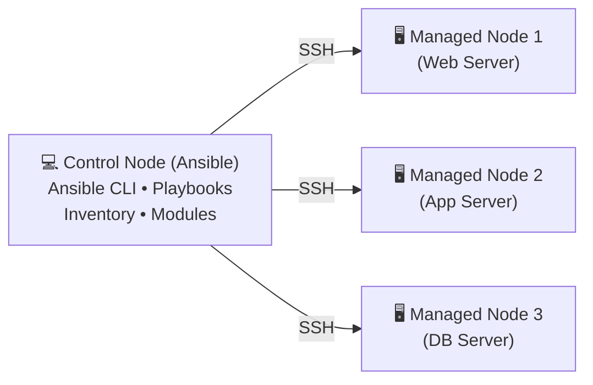
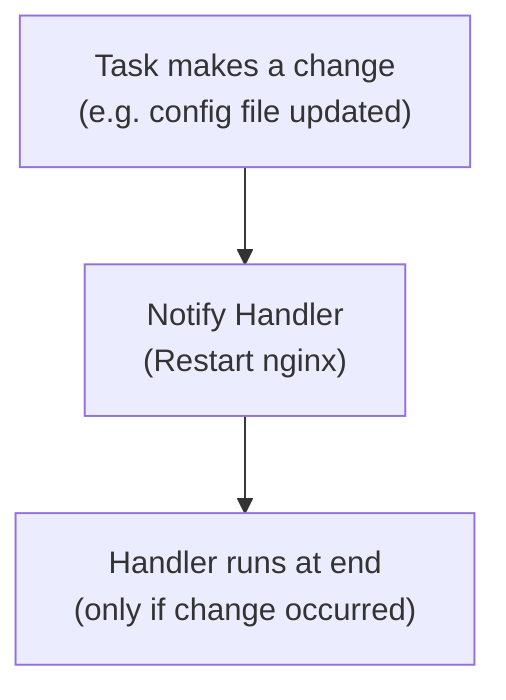

# Ansible

> Automation Made Simple — Agentless. Powerful. Open Source.

[](https://www.ansible.com/)
[](https://opensource.org/licenses/MIT)

A consolidated Ansible reference: theory, hands-on labs, playbooks, roles, vault, alerts, and REST/webhook integration. Originally maintained as Obsidian notes (`Ansible.md`), adapted here for GitHub.

---

## Contents

- [Introduction](#introduction)
- [Installation & First Setup](#installation--first-setup)
- [Inventory](#inventory)
- [Ansible Vault](#ansible-vault)
- [Ad-Hoc Commands & Modules](#ad-hoc-commands--modules)
- [Playbooks & YAML](#playbooks--yaml)
- [Variables, Facts & Conditionals](#variables--facts--conditionals)
- [Loops, Templates, Handlers & Tags](#loops-templates-handlers--tags)
- [Error Handling & Blocks](#error-handling--blocks)
- [Roles](#roles)
- [Full Lab — vsftpd File Server](#full-lab---vsftpd-file-server)
- [Alerts & Notifications](#alerts--notifications)
- [REST APIs & Webhooks](#rest-apis--webhooks)
- [Resources & Links](#resources--links)

---

## Introduction

### What is Ansible?

> [!NOTE]
> Ansible is an **open source** automation tool for configuration management, application deployment, task automation, and orchestration. It manages multiple servers from a single control node **without installing any agent** on target servers (**agentless**).

### Why Use Ansible?

- Simple and easy to learn.
- Agentless (uses SSH).
- Automates repetitive manual tasks.
- Consistent and reliable deployments.
- Supports configuration management and orchestration.
- Idempotent (makes only required changes).
- Large community support (open source).

### Ansible Architecture



> [!TIP]
> Agentless • Push Based • Uses SSH • Manages Multiple Servers • Supports Linux, Windows, Cloud

| Term | Meaning |
| --- | --- |
| Control Node | System where Ansible is installed and from where you run commands. |
| Managed Node | Target servers that Ansible manages. |
| Inventory | List of managed nodes (servers). |
| Playbook | YAML file containing automation tasks. |
| Play | A set of tasks to be executed on hosts. |
| Task | A single action (uses a module). |
| Module | Reusable unit of code to perform a specific task. |
| Role | A way to organize playbooks, files, templates and variables. |

---

## Installation & First Setup

### 1. Install Ansible on Linux (Control Node)

**RHEL / CentOS / Amazon Linux**

```bash
sudo yum install -y epel-release
sudo yum install -y ansible
ansible --version
```

**Ubuntu / Debian**

```bash
sudo apt update
sudo apt install -y ansible
ansible --version
```

### 2. Verify Installation

```bash
ansible --version
```

Expected output (sample):

```text
ansible [core 2.15.0]
  config file = None
  python version = 3.9.16
  executable location = /usr/bin/ansible
```

### 3. Setup SSH Key for Passwordless Authentication

```bash
ssh-keygen -t rsa -b 4096
ssh-copy-id user@<server-ip>
```

> [!NOTE]
> Ansible uses SSH for communication, so **passwordless access is required**.

### 4. Create Inventory File

```bash
sudo nano /etc/ansible/hosts
```

```ini
[web]
web1 ansible_host=192.168.1.10
web2 ansible_host=192.168.1.11

[db]
db1 ansible_host=192.168.1.20
```

### 5. Test Connectivity

```bash
ansible all -m ping
ansible web -m ping
ansible-inventory --list
```

> [!TIP]
> Ansible is installed **only on the Control Node**. Uses **SSH**. **No agent** on managed nodes. Inventory contains the list of servers. Test connectivity before running playbooks.

---

## Inventory

### What is Inventory?

Inventory is a file that contains a **list of managed nodes** (servers) on which Ansible will run commands, playbooks, and modules. It can be a **static file** or **dynamic** (e.g. from AWS, Azure).

### Types of Inventory

| Type | Description | Example |
| --- | --- | --- |
| Static Inventory | Manually create a file with host details. | `inventory.ini` |
| Dynamic Inventory | Generated from cloud providers (AWS, GCP, Azure). | `aws_ec2.py` |
| INI Format | Simple and commonly used format. | `hosts.ini` |
| YAML Format | More structured and powerful format. | `inventory.yml` |

### Static Inventory (INI Format)

```ini
[web]
web1 ansible_host=192.168.1.10
web2 ansible_host=192.168.1.11

[db]
db1 ansible_host=192.168.1.20
```

Groups are defined using `[group_name]`. Hosts are added under each group. You can create child groups using `[parent:children]`. You can also define variables like `ansible_host`, `ansible_user`, etc.

### Inventory in YAML Format

```yaml
all:
  children:
    web:
      hosts:
        web1:
          ansible_host: 192.168.1.10
        web2:
          ansible_host: 192.168.1.11
    db:
      hosts:
        db1:
          ansible_host: 192.168.1.20
```

### Group Variables and Host Variables

- `group_vars/` → Variables for a group (e.g. web, db).
- `host_vars/` → Variables for a specific host.

**Example — `group_vars/web.yml`**

```yaml
app_port: 8080
env: production
app_package: nginx
```

### Dynamic Inventory (AWS EC2)

```bash
ansible-inventory -i aws_ec2.py --list
```

```ini
# or in ansible.cfg
[inventory]
enable_plugins = aws_ec2
plugin = aws_ec2
regions = ap-south-1
keyed_groups:
  - key: tags.Role
    prefix: tag
```

### Useful Commands

```bash
ansible-inventory -i inventory.ini --list   # Test inventory file
ansible all -i inventory.ini -m ping       # Ping all hosts
ansible web -i inventory.ini -m ping       # Ping specific group
ansible web1 -i inventory.ini -m setup     # Check host variables
ansible all -i inventory.yml -m ping       # Use YAML inventory
```

> [!SUCCESS]
> Inventory helps you manage multiple environments (Dev, QA, Prod) easily.

---

## Ansible Vault

### What is Ansible Vault?

Ansible Vault is used to **encrypt sensitive data** such as passwords, API keys, certificates, etc. in playbooks, vars files, or any Ansible file. It helps keep sensitive information secure in a Git repository.

### Why Use Ansible Vault?

- Keeps sensitive data secure.
- Prevents exposing credentials in Git.
- Encrypt entire files or specific variables.
- Easy to use and integrate with playbooks.
- Supports strong AES encryption.

### Vault Commands

| Action | Command |
| --- | --- |
| Encrypt a new file | `ansible-vault create secrets.yml` |
| Edit an existing encrypted file | `ansible-vault edit secrets.yml` |
| View an encrypted file | `ansible-vault view secrets.yml` |
| Encrypt an existing file | `ansible-vault encrypt vars.yml` |
| Decrypt a file | `ansible-vault decrypt vars.yml` |
| Re-encrypt with a new password | `ansible-vault rekey vars.yml` |

### Example — Encrypted Variables File

```bash
ansible-vault create db_credentials.yml
```

```yaml
db_user: admin
db_password: mysecurepassword
db_host: db.example.com
```

### Using Vault in Playbook

```yaml
---
- name: Use encrypted variables
  hosts: web
  vars_files:
    - db_credentials.yml
  tasks:
    - name: Print DB user
      debug:
        msg: "DB User is {{ db_user }}"
```

### Providing Vault Password

```bash
# Prompt for password (interactive):
ansible-playbook site.yml --ask-vault-pass
# Use a password file:
ansible-playbook site.yml --vault-password-file vault.pass
```

```ini
# Set in ansible.cfg:
[defaults]
vault_password_file = ~/.ansible/vault.pass
```

### Encrypt Specific Variables (Inline)

```bash
ansible-vault encrypt_string 'mysecret' --name 'api_key'
```

Output:

```yaml
api_key: !vault |
  $ANSIBLE_VAULT;1.1;AES256
  66386236663933356234646461613430...
```

### Best Practices

- Use strong and unique passwords.
- Store vault password file securely (not in Git).
- Use vault for all sensitive data.
- Restrict access to vault password.
- Rotate vault passwords periodically.
- Use `--vault-id` for multiple vaults (advanced).

> [!WARNING]
> Real passwords and tokens **must not** be written inside notes files — use Vault or placeholders.

---

## Ad-Hoc Commands & Modules

> [!TIP]
> Ad-hoc commands are best for quick tasks, but for complex and reusable automation use Playbooks.

### What are Ad-Hoc Commands?

Ad-hoc commands are **one-liner** Ansible commands used to perform quick tasks on managed nodes without writing a playbook. Useful for testing, troubleshooting, and small automation tasks.

### Basic Ad-Hoc Command Syntax

```bash
ansible <host-pattern> -m <module> -a "<arguments>"
# Example:
ansible all -m ping
```

### Commonly Used Modules

| Module | Purpose | Example Command |
| --- | --- | --- |
| ping | Check connectivity to hosts | `ansible all -m ping` |
| command | Run a command on remote host | `ansible all -m command -a "uptime"` |
| shell | Run a shell command (supports pipes) | `ansible all -m shell -a "df -h \| grep /dev/sda"` |
| copy | Copy files to remote host | `ansible web -m copy -a "src=/tmp/app.sh dest=/home/ubuntu/app.sh"` |
| file | Manage files and directories | `ansible all -m file -a "path=/tmp/test state=directory"` |
| package | Install/Remove packages | `ansible all -m package -a "name=nginx state=present"` |
| service | Manage services | `ansible all -m service -a "name=nginx state=started"` |
| user | Manage users | `ansible all -m user -a "name=devops state=present"` |
| template | Deploy templates (Jinja2) | `ansible all -m template -a "src=app.j2 dest=/etc/app.conf"` |
| debug | Print messages / variables | `ansible all -m debug -a "msg='Hello Ansible'"` |

### Command vs Shell Module

**Command Module:** Runs simple commands. Does not process shell features like pipes, redirection, env vars. **More secure.** Recommended when shell features are not needed.

```bash
ansible all -m command -a "ls -l"
```

**Shell Module:** Runs commands through shell. Supports pipes, redirection, environment variables. **More powerful.** Use **only** when shell features are required.

```bash
ansible all -m shell -a "ps -ef \| grep nginx"
```

### Run Ad-Hoc on Specific Hosts/Groups

- Run on all hosts → `ansible all -m ping`
- Run on a specific group → `ansible web -m ping`
- Run on a specific host → `ansible web1 -m ping`
- Run with sudo (become) → `ansible all -m command -a "whoami" -b`

### Check Available Modules

```bash
ansible-doc -l          # List all modules
ansible-doc copy        # Get help for a module
ansible-doc service -s  # Show module examples (snippet)
```

> [!SUCCESS]
> Ad-hoc commands are useful, but real automation comes from **Playbooks and Roles**.

---

## Playbooks & YAML

### What is a Playbook?

A playbook is a **YAML file** that contains a set of plays. Each play defines a group of hosts and a list of tasks to be executed on those hosts using Ansible modules. Playbooks are used for configuration management, application deployment, and automation.

### Basic Playbook Structure

```yaml
---
- name: Example Playbook
  hosts: web
  become: yes
  tasks:
    - name: Install Nginx
      package:
        name: nginx
        state: present
    - name: Start Nginx Service
      service:
        name: nginx
        state: started
        enabled: yes
```

```bash
ansible-playbook site.yml      # Run the playbook
ansible-playbook site.yml -v   # Verbose output
```

| Element | Description |
| --- | --- |
| Play | Defines a set of tasks for a group of hosts. |
| Task | A single action using a module. |
| Module | Performs a specific operation (e.g. package, service). |
| Inventory | Defines the target hosts. |
| Variables | Store values for reuse. |
| Handlers | Tasks that run only when notified. |
| Roles | Organize playbooks into reusable components. |

### Multiple Plays Example

```yaml
---
- name: Install and Configure Nginx
  hosts: web
  become: yes
  tasks:
    - name: Install nginx
      package: { name: nginx, state: present }
    - name: Start nginx
      service: { name: nginx, state: started }

- name: Deploy Application
  hosts: app
  become: yes
  tasks:
    - name: Copy application files
      copy: { src: /tmp/app/, dest: /opt/app/ }
```

### Useful Playbook Options

```bash
ansible-playbook site.yml --tags "nginx"     # Run specific tags
ansible-playbook site.yml --limit web1       # Limit to specific hosts
ansible-playbook site.yml --syntax-check     # Check syntax before running
ansible-playbook site.yml --check            # Dry run (check mode)
```

> [!TIP]
> Use meaningful names for plays and tasks. Keep playbooks modular (use roles). Use variables instead of hardcoding. Use idempotent modules. Keep playbooks in version control (Git). Use tags for selective execution. Test in lower environments (Dev/QA) first.

---

## Variables, Facts & Conditionals

### What are Variables?

Variables store values that can be reused in playbooks, roles, or inventory. They make playbooks dynamic, flexible, and easy to maintain. The same playbook can be used for different environments just by changing variable values.

### Ways to Define Variables

**2.1 Define in Playbook**

```yaml
---
- hosts: web
  vars:
    app_name: nginx
    app_port: 8080
  tasks:
    - name: Print variable
      debug:
        msg: "App is {{ app_name }}"
```

**2.2 External Variables File — `vars.yml`**

```yaml
app_name: nginx
app_port: 8080
```

```yaml
- hosts: web
  vars_files:
    - vars.yml
```

**2.3 Inventory Variables**

```ini
# in inventory file
[web]
web1 ansible_host=192.168.1.10 app_port=8080
```

```yaml
# or in group_vars/web.yml
app_name: nginx
app_port: 8080
```

### Variable Precedence (High to Low)

1. Extra variables (`-e`) — (Highest)
2. Task variables
3. Block variables
4. Role variables
5. Play variables
6. Variables files (`vars_files`)
7. Inventory variables (`host_vars`, `group_vars`)
8. Facts (`ansible_facts`)
9. Default variables (role defaults) — (Lowest)

### Ansible Facts

Ansible Facts are **system information automatically collected** from managed nodes. Stored in the `ansible_facts` variable. Useful to get OS, IP, kernel, memory, etc.

```bash
ansible web -m setup                                  # Get all facts
ansible web -m setup -a "filter=ansible_os_family"    # Get specific fact
```

```yaml
- name: Print OS information
  hosts: web
  tasks:
    - debug:
        msg: "OS is {{ ansible_os_family }}"
```

### Register Variable

Used to store the **output of a task** in a variable. You can use this variable in later tasks.

```yaml
- name: Check disk space
  shell: df -h
  register: disk_output
- name: Show output
  debug:
    var: disk_output.stdout_lines
```

### set_fact Module

Used to define variables **during runtime**.

```yaml
- name: Set a fact
  set_fact:
    my_message: "Hello Ansible"
- name: Use the fact
  debug:
    msg: "{{ my_message }}"
```

### Conditions (when)

Used to execute a task **only when a condition is true**.

```yaml
- name: Install nginx only on RedHat
  package:
    name: nginx
    state: present
  when: ansible_os_family == "RedHat"
```

| Condition | Description |
| --- | --- |
| changed_when | Define when a task is considered changed. |
| failed_when | Define when a task should fail. |
| when | Run task based on condition. |
| ignore_errors | Ignore failures (not recommended). |
| any_errors_fatal | Stop execution if any host fails. |

---

## Loops, Templates, Handlers & Tags

### Loops in Ansible

Loops run a task **multiple times with different values**.

**1.1 `loop` (preferred)**

```yaml
- name: Install multiple packages
  hosts: web
  tasks:
    - name: Install packages
      package:
        name: "{{ item }}"
        state: present
      loop:
        - nginx
        - git
        - curl
```

**1.2 `with_items` (legacy)**

```yaml
- name: Create multiple users
  hosts: web
  tasks:
    - name: Create users
      user:
        name: "{{ item }}"
        state: present
      with_items:
        - user1
        - user2
        - user3
```

> [!TIP]
> `loop` is the **latest and recommended** syntax. `with_items` is **legacy** (still works). `item` is used to access each value. Can loop over lists, files, dictionaries, etc.

### Jinja2 Templates

Templates create **dynamic configuration files** using variables. Ansible uses the **Jinja2** templating engine.

**Template file (`nginx.conf.j2`)**

```jinja
server {
    listen {{ app_port }};
    server_name {{ server_name }};
    location / {
        proxy_pass http://{{ backend }};
    }
}
```

**Playbook using Template**

```yaml
- name: Deploy Nginx config
  hosts: web
  tasks:
    - name: Copy template
      template:
        src: nginx.conf.j2
        dest: /etc/nginx/nginx.conf
      notify: Restart nginx
```

### Handlers in Ansible

Handlers are **special tasks that run only when notified** by another task (when there is a change).

```yaml
- name: Install and configure Nginx
  hosts: web
  tasks:
    - name: Copy config
      template:
        src: nginx.conf.j2
        dest: /etc/nginx/nginx.conf
      notify: Restart nginx
  handlers:
    - name: Restart nginx
      service:
        name: nginx
        state: started
```



> [!TIP]
> Handlers run **only when notified**. Useful for service restarts. Multiple tasks can notify the same handler. Handlers run at the **end of the play** (not immediately).

### Tags in Ansible

Tags are used to **run specific tasks** from a playbook.

```yaml
- name: Install Nginx
  hosts: web
  tasks:
    - name: Install nginx
      package:
        name: nginx
        state: present
      tags: ["install"]
    - name: Start nginx
      service:
        name: nginx
        state: started
      tags: ["start"]
```

```bash
ansible-playbook site.yml --tags install
ansible-playbook site.yml --tags start
ansible-playbook site.yml --skip-tags install
```

> [!SUCCESS]
> Use loops, templates, handlers, and tags to make your playbooks **modular**, **reusable**, and **efficient**.

---

## Error Handling & Blocks

The `block` groups several tasks under a single `when` condition or error policy (`rescue` / `always`).

```yaml
---
- name: Playing with file module
  hosts: all
  vars:
    hosts_file: /etc/hosts
  tasks:
    - name: Delete old host file and generate new one
      block:
        - name: Delete existing host file
          ansible.builtin.file:
            path: "{{ hosts_file }}"
            state: absent
        - name: Generate new "{{ hosts_file }}"
          ansible.builtin.template:
            src: hosts.j2
            dest: "{{ hosts_file }}"
            owner: root
            group: root
            mode: '0644'
      when: ansible_hostname in groups['dc2']
```

> [!INFO]
> `when` at the **block level** applies to both tasks together (delete then generate) instead of repeating it twice.

---

## Roles

### What are Ansible Roles?

Roles organize playbooks and related files (tasks, handlers, variables, templates, etc.) into a structured directory. They make playbooks **modular, reusable, and easy to maintain**.

### Role Directory Structure

```text
myrole/
├── tasks/main.yml
├── handlers/main.yml
├── templates/file.j2
├── files/app.conf
├── vars/main.yml
├── defaults/main.yml
└── meta/main.yml
```

| Directory | Purpose |
| --- | --- |
| tasks | Contains main tasks for the role. |
| handlers | Contains handlers (e.g. restart service). |
| templates | Jinja2 templates. |
| files | Static files to be copied. |
| vars | Role-specific variables (high precedence). |
| defaults | Default variables (low precedence). |
| meta | Metadata (dependencies, role info). |

### Create a Role

```bash
ansible-galaxy init nginx
```

### Using a Role in Playbook

```yaml
---
- name: Install and configure Nginx using role
  hosts: web
  become: yes
  roles:
    - nginx
```

**Passing Variables to a Role**

```yaml
---
- hosts: web
  roles:
    - role: nginx
      vars:
        nginx_port: 8080
```

### Role Variables (`defaults` vs `vars`)

```yaml
# defaults/main.yml (low precedence)
nginx_port: 80
nginx_user: www-data
```

```yaml
# vars/main.yml (high precedence)
nginx_version: 1.24
nginx_conf_path: /etc/nginx/nginx.conf
```

> [!TIP]
> Use `defaults` for values that **can be overridden**. Use `vars` for **fixed values**. Playbook variables **override both**.

### Role Dependencies (`meta/main.yml`)

```yaml
dependencies:
  - role: common
  - role: mysql
    vars:
      mysql_version: 8.0
```

Roles can depend on other roles. Dependencies are defined in `meta/main.yml`. Dependencies are executed **before** the current role.

### Useful Commands

```bash
ansible-galaxy init <role_name>   # Create a new role
ansible-galaxy install <role_name> # Install a role from Galaxy
ansible-galaxy list                # List installed roles
```

> [!TIP]
> Keep roles small and focused. Use meaningful names. Document variables in README. Use role dependencies for common components. Store roles in version control (Git).

---

## Full Lab — vsftpd File Server

This final lab combines everything: `vars_files` + template + notify/handler + firewalld + copy + SELinux `setype` — then real verification with an `lftp` client.

### Lab Files

```text
.
├── ansible.cfg
├── fileServer.yml
├── hosts.j2
├── inventory
├── MaFiMudul.yml
├── temp
│   └── ftp_data
│       ├── another_file
│       └── testfile.txt
├── vsftpd_conf.j2
└── vsftpd_vars.yml
```

**`vsftpd_conf.j2`**

```jinja
listen=YES
anonymous_enable={{ anonymous_enable }}
local_enable={{ local_enable }}
write_enable={{ write_enable }}
local_umask=022
connect_from_port_20=YES
pam_service_name=vsftpd
```

**`vsftpd_vars.yml`**

```yaml
package: vsftpd
service: vsftpd
firewall_service: ftp
ftp_dir: /var/ftp/pub/
src_dir: temp/ftp_data/
config_file: /etc/vsftpd/vsftpd.conf
anonymous_enable: YES
local_enable: YES
write_enable: YES
```

**`fileServer.yml`**

```yaml
---
- name: Build your file server
  hosts: file_server
  vars_files:
    - vsftpd_vars.yml
  tasks:
    - name: Install vsftpd
      ansible.builtin.yum:
        name: "{{ package }}"
        state: latest
    - name: Configure {{ service }}
      ansible.builtin.template:
        src: vsftpd_conf.j2
        dest: "{{ config_file }}"
        owner: root
        group: root
        mode: '0644'
      notify: restart vsftpd
    - name: Enable and start service vsftpd
      ansible.builtin.service:
        name: "{{ service }}"
        state: started
        enabled: yes
    - name: Allow port in firewall
      ansible.posix.firewalld:
        service: "{{ firewall_service }}"
        immediate: yes
        permanent: yes
        state: enabled
    - name: Copy file to {{ ftp_dir }}
      ansible.builtin.copy:
        src: "{{ src_dir }}"
        dest: "{{ ftp_dir }}"
        owner: ansible
        group: ansible
        mode: '0664'
        setype: public_content_t
  handlers:
    - name: restart vsftpd
      ansible.builtin.service:
        name: "{{ service }}"
        state: restarted
```

### Run and Verify

```bash
ansible-playbook fileServer.yml --syntax-check
ansible-playbook fileServer.yml --list-hosts
ansible-playbook -v fileServer.yml
```

Sample `lftp` verification session:

```text
lftp ansible1
lftp ansible1:~> ls
drwxr-xr-x    2 0        0              46 Apr 29 21:13 pub
lftp ansible1:/> cd pub/
lftp ansible1:/pub> ls
-rw-rw-r--    1 1001     1001            0 Apr 29 21:13 another_file
-rw-rw-r--    1 1001     1001           28 Apr 29 21:13 testfile.txt
lftp ansible1:/pub> exit
```

> [!TIP]
> Task order is intentional: **configure before starting** (template then service) — the reverse of the common wrong order. `setype: public_content_t` allows vsftpd to read copied files under SELinux. The `lftp` session proves the files actually arrived with permissions `0664` — verifying the **final result**, not just playbook success.

---

## Alerts & Notifications

Automation without notifications is blind: send deployment results to Discord or Telegram directly from the playbook using `community.general` modules.

### Discord

```yaml
- name: Send a message to the Discord channel
  community.general.discord:
    webhook_id: "00000"
    webhook_token: "XXXYYY"
    content: "This is a message from ansible"
```

Embedded message:

```yaml
- name: Send an embedded message to the Discord channel
  community.general.discord:
    webhook_id: "00000"
    webhook_token: "XXXYYY"
    embeds:
      - title: "Embedded message"
        description: "This is an embedded message"
        footer:
          text: "Author: Ansible"
        image:
          url: "https://docs.ansible.com/ansible/latest/_static/images/logo_invert.png"
```

### Telegram

```yaml
- name: Send notify to Telegram
  community.general.telegram:
    token: '9999999:XXXXXXXXXXXXXXXXXXXXXXX'
    api_args:
      chat_id: 000000
      parse_mode: "markdown"
      text: "Your precious application has been deployed: https://example.com"
      disable_web_page_preview: true
      disable_notification: true
```

> [!WARNING]
> `webhook_token` and `token` in the examples are placeholders. Put real values in an encrypted file via [Ansible Vault](#ansible-vault) and never commit them to Git.

---

## REST APIs & Webhooks

Not every alert is tied to a task failure: sometimes you want to query a REST API and send an alert based on a value in the response, not on success/failure of the task.

### Basic Scenario

Query a REST API and send an alert to a remote webhook if the API returns a `Status` value other than `Operational`. Assumes Bearer Token authentication.

### Performing the API Query

```yaml
- name: Perform API GET to return the status of remote service
  uri:
    url: "{{ your_api_endpoint }}"
    method: GET
    return_content: yes
    body_format: json
    status_code: 200
    headers:
      Authorization: "Bearer {{ your_bearer_token }}"
  register: results_of_get
  no_log: True
```

- **Line 7:** Defines the return code as HTTP 200; any other return code results in failure.
- **Lines 8-9:** Defines that a Bearer Token be sent as a header.
- **Line 10:** The GET results are saved in `results_of_get`.
- **Line 11:** No log is displayed in the console, as the token would be shown in the clear.

### Manipulating Returned Data and Sending to a Webhook

```yaml
- name: Read the return data and POST to webhook if anything other than Operational is found in Status
  uri:
    url: "{{ your_incoming_webhook }}"
    method: POST
    return_content: yes
    body: '{ YOUR BODY HERE }'
    body_format: json
  when:
    - results_of_get.json.value[0].Status != 'Operational'
```

### Practical Example — Microsoft Teams Webhooks

```yaml
---
- name: GET_and_POST
  hosts: localhost
  gather_facts: false
  any_errors_fatal: true
  vars:
    your_api_endpoint: "https://some.imaginaryorg.com/fictional/endpoint"
    your_incoming_webhook: "https://outlook.office.com/webhook/<TEAMS_WEBHOOK_UID>"
  tasks:
  - name: Perform API GET to return the status of remote service
    uri:
      url: "{{ your_api_endpoint }}"
      method: GET
      return_content: yes
      body_format: json
      status_code: 200
      headers:
        Authorization: "Bearer {{ your_bearer_token }}"
    register: results_of_get
    no_log: True
  - name: Read the return data and POST to webhook if anything other than Operational is found in Status
    uri:
      url: "{{ your_incoming_webhook }}"
      method: POST
      return_content: yes
      body: '{"@type":"MessageCard","@context":"http://schema.org/extensions","themeColor":"0076D7","summary":"FAILURE"}'
      body_format: json
    when:
      - results_of_get.json.value[0].Status != 'Operational'
```

This generates a Message Card notification in Teams with the summary FAILURE when the Status is anything other than Operational. A useful payload designer exists at [MessageCard Playground](https://messagecardplayground.azurewebsites.net/).

This can be linked to a schedule via cron or, if using Ansible Tower, via the native beat scheduler.

---

## Resources & Links

### Courses & Videos

- [Jinja2 Basics Mini Course — KodeKloud](https://notes.kodekloud.com/docs/Jinja2-Basics-Mini-Course/Jinja2/Jinja2-Basics)
- [Ansible Advanced Course — Introduction](https://notes.kodekloud.com/docs/Ansible-Advanced-Course/Introduction/Course-Introduction)
- [with Keroles — YouTube Playlist](https://www.youtube.com/playlist?list=PLdTZTP1X_y5o3p7mpMy4T-3X8ukgFg9kJ)
- [with Alaa Mohamed — YouTube Playlist](https://www.youtube.com/playlist?list=PLvbyo73L4vfthKUsf0guv2uxrAy255Ht-)

### Labs & Execution Environments

- [KodeKloud Free Labs — Ansible](https://kodekloud.com/pages/free-labs/ansible)
- [Killercoda — Ansible Labs (het-tanis)](https://killercoda.com/het-tanis/course/Ansible-Labs)
- [ansible-executions-env — HamidM92](https://github.com/HamidM92/ansible-executions-env)
- [arm-nas — geerlingguy](https://github.com/geerlingguy/arm-nas/?s=09)

### Tools & Platforms

- [Kestra — Workflow Orchestration](https://kestra.io/)
- [Semaphore UI — Web UI for Ansible](https://semaphoreui.com/)
- [Ansible Playbook Generator — syshunt](https://syshunt.com/ansible-playbook-generator/)

### Articles & Projects

- [DevOpsLand — xavki (Ansible)](https://gitlab.com/xavki/devopsland/-/tree/master/ansible?ref_type=heads)
- [Top 10 Ansible Playbooks for Network Automation — orhanergun](https://orhanergun.net/top-10-ansible-playbooks-for-efficient-network-automation)
- [12 Best Practices Before Running a Playbook on RHEL — Medium](https://medium.com/@jeromedecinco/12-best-practices-to-follow-before-running-an-ansible-playbook-on-red-hat-enterprise-linux-37ccd16b4834#808e)
- [Ansible Prompts and Runtime Variables — linuxconfig](https://linuxconfig.org/introduction-to-ansible-prompts-and-runtime-variables)

### Galaxy, Azure & RHEL System Roles

- [Galaxy — azure.azure_modules](https://galaxy.ansible.com/ui/standalone/roles/azure/azure_modules/versions/)
- [GitHub — Azure/azure_modules](https://github.com/Azure/azure_modules)
- [Galaxy User Guide](https://docs.ansible.com/ansible/latest/galaxy/user_guide.html)
- [Roles — Official Documentation](https://docs.ansible.com/ansible/latest/playbook_guide/playbooks_reuse_roles.html)
- [Ansible Ecosystem](https://docs.ansible.com/ansible/latest/ecosystem.html)

### Official Documentation References

- [Standard Loops](https://docs.ansible.com/ansible/latest/playbook_guide/playbooks_loops.html#standard-loops)
- [Conditionals](https://docs.ansible.com/ansible/latest/playbook_guide/playbooks_conditionals.html)
- [Handlers](https://docs.ansible.com/ansible/latest/playbook_guide/playbooks_handlers.html#handlers) • [meta module](https://docs.ansible.com/ansible/latest/collections/ansible/builtin/meta_module.html#meta-module)
- [Blocks — Error Handling](https://docs.ansible.com/ansible/latest/playbook_guide/playbooks_blocks.html#error-handling) • [Error Handling](https://docs.ansible.com/ansible/latest/playbook_guide/playbooks_error_handling.html)
- [Strategies](https://docs.ansible.com/ansible/latest/playbook_guide/playbooks_strategies.html)
- [FAQ — Encrypted passwords for the user module](https://docs.ansible.com/ansible/latest/reference_appendices/faq.html#how-do-i-generate-encrypted-passwords-for-the-user-module)

---

> [!NOTE] Full reference
> The complete lab notes (with original lab outputs, toggled examples, and Arabic annotations) are maintained in `Ansible.md`. This README is the GitHub-friendly summary.
